# 6.2. Landing Page, Services & Applications Implementation

En esta sección se explica y evidencia el proceso de implementación, pruebas, documentación y despliegue del Landing 
Page, Web Services, Web Applications, Mobile Applications y Embedded Applications que conforman la solución StorePulse.
Para esta primera etapa de desarrollo, el esfuerzo del equipo se 
concentra en la ejecución y documentación del Sprint 1 que tiene como objetivo principal la construcción y 
el despliegue de la Landing Page como primer entregable del proyecto, utilizando HTML5, CSS3 y JavaScript. De esta manera, 
se establece el canal digital inicial para presentar el modelo de negocio a los administradores de galerías comerciales
y a los inquilinos, cumpliendo con la meta técnica de implementar y desplegar exitosamente las primeras versiones del 
sitio web estático y de las Frontend Web Applications.

## 6.2.1. Sprint 1

En esta sección se registra y explica el avance de la solución StorePulse en términos de producto y trabajo 
colaborativo correspondiente al Sprint 1. Para esta primera iteración, alineada con los objetivos de evaluación. 
El esfuerzo del equipo se enfoca en establecer los cimientos digitales e informativos de 
la plataforma. De acuerdo con la priorización definida en el Product Backlog, el alcance principal de este sprint 
abarca la implementación y el despliegue de la primera versión de la Landing Page como primer entregable del
proyecto, así como el despliegue inicial de las Frontend Web Applications. A lo largo de este apartado se detallarán
las actividades realizadas por VanguardTech, abarcando la planificación de la iteración, la asignación de tareas 
en el Sprint Backlog, y las evidencias concretas de desarrollo, pruebas, ejecución, documentación de servicios 
y configuración de despliegue.

### 6.2.1.1. Sprint Planning 1

En esta sección se detallan los aspectos principales y los acuerdos definidos durante el Sprint Planning Meeting 
correspondiente al Sprint 1 del proyecto StorePulse. El objetivo de esta reunión fue establecer las bases para el 
primer ciclo de desarrollo, definiendo la capacidad del equipo (Velocity) y seleccionando las historias de usuario 
prioritarias del Product Backlog. Para este primer sprint, el equipo determinó que el mayor valor de negocio reside en 
la construcción y despliegue de la Landing Page informativo, así como en la configuración inicial del entorno para las 
Frontend Web Applications. A continuación, se presenta el cuadro resumen de la planificación, el cual incluye los datos
de la reunión, el Sprint Goal formulado bajo el enfoque recomendado enfocado en el negocio y los usuarios, y el 
esfuerzo total estimado en Story Points.

| **Sprint #** | **Sprint 1**                                                                                                                                                                                                                                                                                                                                                                                                                                                                                                                                                                                                                                                                              |
| :--- |:------------------------------------------------------------------------------------------------------------------------------------------------------------------------------------------------------------------------------------------------------------------------------------------------------------------------------------------------------------------------------------------------------------------------------------------------------------------------------------------------------------------------------------------------------------------------------------------------------------------------------------------------------------------------------------------|
| **Sprint Planning Background** |                                                                                                                                                                                                                                                                                                                                                                                                                                                                                                                                                                                                                                                                                           |
| Date | 29 - 09 - 2026                                                                                                                                                                                                                                                                                                                                                                                                                                                                                                                                                                                                                                                                            |
| Time | 2:00 PM                                                                                                                                                                                                                                                                                                                                                                                                                                                                                                                                                                                                                                                                                   |
| Location | Aula - 8741                                                                                                                                                                                                                                                                                                                                                                                                                                                                                                                                                                                                                                                                               |
| Prepared By | Araujo Ingunza, Renzo José                                                                                                                                                                                                                                                                                                                                                                                                                                                                                                                                                                                                                                                                     |
| Attendees (to planning meeting) | Araujo Ingunza, Renzo José / Carranza Tesén, Joaquín Enrique / Cordova Valdivia, Sebastián / Curi Marcelo, Angelo Marcio / Diaz Gutierrez, Henry Kevin / Esquivel León, Miguel Juan Diego                                                                                                                                                                                                                                                                                                                                                                                                                                                                                                                                                                                    |
| Sprint n – 1 Review Summary | No aplica (al ser el primer Sprint del proyecto, no existen resultados ni feedback de un sprint previo).                                                                                                                                                                                                                                                                                                                                                                                                                                                                                                                                                                                  |
| Sprint n – 1 Retrospective Summary | No aplica (al ser el primer Sprint del proyecto, no existen retrospectivas previas).                                                                                                                                                                                                                                                                                                                                                                                                                                                                                                                                                                                                      |
| **Sprint Goal & User Stories** |                                                                                                                                                                                                                                                                                                                                                                                                                                                                                                                                                                                                                                                                                           |
| Sprint n Goal | **Our focus is on** providing gallery administrators and tenants with a deployed Landing Page that clearly explains the value proposition, and establishing the initial deployment of the Frontend Web Applications.<br><br>**We believe it delivers** a reliable digital channel to attract early adopters, communicate our services (features, subscription plans, and team), and test our value proposition, while setting a solid technical foundation for the development team.<br><br>**This will be confirmed when** visitors can successfully access the website to read about StorePulse's features and terms, and the frontend baseline is accessible in the cloud environment. |
| Sprint n Velocity | 12 Story Points                                                                                                                                                                                                                                                                                                                                                                                                                                                                                                                                                                                                                                                                           |
| Sum of Story Points | 12 Story Points, correspondientes a las Visitor Stories VS-01 a VS-09 del Landing Page (1+2+2+2+1+1+1+1+1), segun la estimacion registrada en el Product Backlog de la seccion 3.3.                                                                                                                                                                                                                                                                                                                                                                                                                                                                                                                                        |


### 6.2.1.2. Aspect Leaders and Collaborators

En esta sección se presenta el Leadership-and-Collaboration Matrix (LACX) correspondiente al Sprint 1, el cual detalla 
quién asume el rol de líder (L) y quiénes actúan como colaboradores (C) para cada aspecto dentro del alcance de la 
iteración. Esta matriz tiene como fin brindar mayor claridad y efectividad en la comunicación al interior del 
equipo durante el desarrollo de las tareas planificadas.

Para este primer Sprint, el alcance funcional y técnico se ha dividido en tres aspectos principales alineados al Sprint Goal:
1. **Landing Page Implementation:** Abarca el desarrollo con HTML5, CSS3 y JavaScript del sitio web estático informativo
de StorePulse. Cabe resaltar que, por lineamientos del proyecto, todos los participantes deben colaborar activamente en 
la implementación de este aspecto.
2. **Frontend Web Applications Configuration:** Involucra la configuración inicial del entorno de desarrollo para las 
aplicaciones web (Angular) y la estructuración base del proyecto.
3. **Software Deployment & Environment Setup:** Comprende la configuración de repositorios en GitHub, estrategias de 
ramificación (GitFlow) y el despliegue inicial en la nube de la Landing Page y el entorno Frontend.

A continuación, se presenta la matriz LACX con la distribución de responsabilidades del equipo de VanguardTech:

| Team Member (Last Name, First Name) | GitHub Username | Landing Page Implementation Leader (L) / Collaborator (C) | Frontend Web Applications Configuration Leader (L) / Collaborator (C) | Software Deployment & Environment Setup Leader (L) / Collaborator (C) |
|:------------------------------------|:----------------| :---: | :---: | :---: |
| Araujo Ingunza, Renzo José          | RnArauj0        | C | C | L |
| Carranza Tesén, Joaquín Enrique     | thepima         | C | C | C |
| Cordova Valdivia, Sebastián         | Sevas04         | L | C | C |
| Curi Marcelo, Angelo Marcio         | AngeloC12       | C | C | C |
| Diaz Gutierrez, Henry Kevin         | HenryDiaz12     | C | L | C |
| Esquivel León, Miguel Juan Diego    | juandyoff       | C | C | C |

Conforme a lo indicado en el enunciado del trabajo final, la organización de líderes y colaboradores guarda relación 
directa con la selección de tasks del Sprint Backlog presentada en la sección siguiente: cada aspecto cuenta con un 
líder responsable de su integración, y la totalidad del equipo participa como colaborador en la implementación del 
Landing Page.

### 6.2.1.3. Sprint Backlog 1

En esta sección se presenta el Sprint Backlog correspondiente al Sprint 1, el cual refleja la organización 
detallada de las tareas necesarias para cumplir con el Sprint Goal. El principal objetivo de esta 
iteración es proveer a los administradores de galerías e inquilinos, una Landing Page desplegado que 
comunique la propuesta de valor de StorePulse de forma diferenciada, además de establecer el entorno y 
despliegue inicial de las aplicaciones Frontend.

A continuación, se presenta una captura del tablero de control utilizado (Trello), junto con el enlace 
público para su revisión. Posteriormente, se detalla la tabla de control de estado del Sprint, 
especificando las User/Visitor Stories asignadas, las tareas (Work-Items) derivadas de su descomposición 
técnica, su estimación en horas, el responsable asignado según la matriz LACX y el estado de avance.
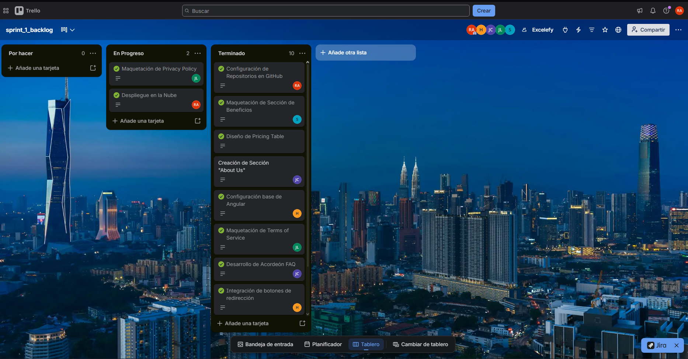

https://trello.com/b/ZAyHEpKs 

**Sprint # 1**

| Story Id | Story Title | Task Id | Task Title | Task Description | Estimation (Hours) | Assigned To | Status (To-do / In-Process / To-Review / Done) |
| :--- | :--- | :--- | :--- | :--- | :--- | :--- | :--- |
| VS-01 | Conocer el propósito de StorePulse| TSK-01 | Diseño de Header y Hero Section | Maquetar la sección principal (Hero) del Landing Page en HTML/CSS. | 3 | Cordova Valdivia, Sebastián | Done |
| VS-02 | Conocer los beneficios según segmento | TSK-02 | Maquetación de Sección de Beneficios | Construir la sección de beneficios diferenciando la propuesta de valor para cada segmento. | 4 | Cordova Valdivia, Sebastián | Done |
| VS-03 | Conocer el funcionamiento de la solución | TSK-03 | Implementación de Sección "Cómo Funciona" | Diseñar la sección que explica el flujo de la plataforma con iconos y descripciones, incluyendo el contenido alternativo en texto e imágenes. | 3 | Curi Marcelo, Angelo Marcio | Done |
| VS-04 | Conocer los planes de suscripción | TSK-04 | Diseño de Pricing Table | Crear la tabla de precios estática mostrando los planes de suscripción. | 4 | Curi Marcelo, Angelo Marcio | Done |
| VS-05 | Resolver dudas frecuentes| TSK-05 | Desarrollo de Acordeón FAQ | Implementar una sección interactiva de preguntas frecuentes con JavaScript, cubriendo instalación, costo y funcionamiento. | 3 | Carranza Tesén, Joaquín Enrique | Done |
| VS-06 | Acceder o registrarse en la plataforma | TSK-06 | Integración de botones de redirección | Configurar botones de Sign In y Sign Up hacia las rutas iniciales de la plataforma. | 2 | Diaz Gutierrez, Henry Kevin | Done |
| VS-07 | Conocer al equipo de StorePulse | TSK-07 | Creación de Sección "About Us" | Maquetar la sección del equipo incluyendo las fotografías, nombres y roles. | 2 | Carranza Tesén, Joaquín Enrique | Done |
| VS-08 | Consultar los términos de servicio | TSK-08 | Maquetación de Terms of Service | Crear el archivo HTML para los Términos de Servicio y enlazarlo en el footer. | 2 | Esquivel León, Miguel Juan Diego | Done |
| VS-09 | Consultar la política de privacidad | TSK-09 | Maquetación de Privacy Policy | Crear el archivo HTML para la Política de Privacidad y enlazarlo en el footer. | 2 | Esquivel León, Miguel Juan Diego | Done |
| - | Constraint Técnico | TSK-10 | Configuración de Repositorios en GitHub | Crear repositorios para el proyecto aplicando GitFlow y convenciones iniciales. | 2 | Araujo Ingunza, Renzo José | Done |
| - | Constraint Técnico | TSK-11 | Configuración base de Angular | Inicializar el proyecto Angular, configurando el ruteo base y dependencias de arquitectura. | 4 | Diaz Gutierrez, Henry Kevin | Done |
| - | Constraint Técnico | TSK-12 | Despliegue en la Nube | Desplegar el Landing Page y el entorno base de la Web App en el hosting de nube elegido. | 3 | Araujo Ingunza, Renzo José | Done |

El esfuerzo total estimado asciende a **34 horas**, distribuidas entre los seis integrantes del equipo: Cordova Valdivia 
(7 h), Curi Marcelo (7 h), Diaz Gutierrez (6 h), Araujo Ingunza (5 h), Carranza Tesén (5 h) y Esquivel León (4 h).

### 6.2.1.4. Development Evidence for Sprint Review

En esta sección se explica y presenta los avances en implementación con relación a los productos de la solución según
el alcance del Sprint. Durante el Sprint 1, el equipo construyó la primera versión completa del **Landing Page** de
StorePulse con HTML5, CSS3 y JavaScript, abarcando las secciones que dan respuesta a las Visitor Stories comprometidas,
y la primera versión de la **Web Application** del Gallery Administrator en Angular, organizada por Bounded Contexts:
cada integrante implementó al menos un contexto sobre una estructura común definida al inicio del Sprint.

El trabajo se organizó aplicando **GitFlow** como estrategia de ramificación —una rama `feature/` por funcionalidad o
Bounded Context, integrada a `develop`— y **Conventional Commits** como convención de mensajes, de modo que el
historial permite identificar el aporte individual de cada integrante y el tipo de cambio introducido.

Los repositorios que conforman la solución en este Sprint son los siguientes:

| Repository | Propósito | Alcance en el Sprint 1 |
| :--- | :--- | :--- |
| `VanguardTechIot/storepulse-report` | Informe académico del proyecto en formato Markdown | Documentación de los capítulos I a VI |
| `VanguardTechIot/storepulse-landing-page` | Sitio web estático informativo (HTML5, CSS3, JavaScript) | Versión 1.0.0 publicada en GitHub Pages |
| `VanguardTechIot/storepulse-web-application` | Aplicación web del Gallery Administrator (Angular) | Versión 0.1.1 con nueve Bounded Contexts, publicada en Firebase Hosting |

A continuación se detallan los commits más representativos del desarrollo del Landing Page y de la Web Application.
Cuando el commit no tiene cuerpo, la columna *Commit Message Body* resume el cambio que introduce.

| Repository | Branch | Commit Id | Commit Message | Commit Message Body | Commited on (Date) |
| :--- | :--- | :--- | :--- | :--- | :--- |
| VanguardTechIot/storepulse-landing-page | feature/landing-page-setup | `8fe9a06` | chore: initial commit | Creación del repositorio del Landing Page | 2026-10-08 |
| VanguardTechIot/storepulse-landing-page | feature/landing-page-setup | `b8fdac4` | feat(setup): add base layout, header, hero section and iot solutions | Header, Hero Section con la propuesta de valor y sección de soluciones IoT (VS-01, VS-03) | 2026-10-08 |
| VanguardTechIot/storepulse-landing-page | feature/landing-page-setup | `04c2619` | feat(setup): add base landing page structure, styles and interactive components | Estructura completa, estilos y componentes interactivos: beneficios, planes y preguntas frecuentes (VS-02, VS-04, VS-05) | 2026-10-08 |
| VanguardTechIot/storepulse-landing-page | feature/landing-page-setup | `7b66352` | feat(setup): add base landing page layout, styles and interactive components | Ajustes de maquetación y del comportamiento de los componentes interactivos | 2026-10-08 |
| VanguardTechIot/storepulse-landing-page | feature/landing-page-setup | `df1cb03` | feat(setup): add base landing page with resolved assets and pre-launch navigation | Recursos gráficos resueltos y navegación hacia el registro y el inicio de sesión (VS-06) | 2026-10-08 |
| VanguardTechIot/storepulse-landing-page | feature/landing-page-setup | `4a16abd` | feat(assets): add team photographs for about us section | Fotografías del equipo para la sección About Us (VS-07) | 2026-10-08 |
| VanguardTechIot/storepulse-landing-page | develop | `3c483fc` | Merge branch 'feature/landing-page-setup' into develop | Integración del Landing Page en develop | 2026-10-08 |
| VanguardTechIot/storepulse-landing-page | main | `14ddb02` | Merge branch 'release/1.0.0' into main | Publicación de la versión 1.0.0 del Landing Page (tag 1.0.0) | 2026-10-09 |
| VanguardTechIot/storepulse-web-application | feature/frontend-directory-structure | `150f23f` | feature: add .gitkeep files to maintain empty directories | Estructura inicial de directorios por Bounded Context | 2026-10-06 |
| VanguardTechIot/storepulse-web-application | feature/web-application-structure | `94fa1ec` | feature: restructure directories following the DDD statement and add localization files for English and Spanish | Estructura por capas según DDD y archivos de traducción en inglés y español | 2026-10-08 |
| VanguardTechIot/storepulse-web-application | feature/web-billing | `064ab82` | feat: add utility billing functionality | Bounded Context Utility Billing: facturas, desglose de consumo y reclamos | 2026-10-08 |
| VanguardTechIot/storepulse-web-application | feature/monitoring | `28283c6` | feat(monitoring): add monitoring domain model, infrastructure and store | Modelo de dominio, infraestructura y store de Service Execution and Monitoring | 2026-10-08 |
| VanguardTechIot/storepulse-web-application | feature/monitoring | `ffd832e` | feat(monitoring): implement monitoring views | Vistas de telemetría, alertas, consumo y reglas de monitoreo | 2026-10-08 |
| VanguardTechIot/storepulse-web-application | feature/bounded-context-iam | `43ee2e3` | feature(iam): Add entities, value-objects, commands and enums in the domain layer. | Capa de dominio de Identity and Access Management | 2026-10-08 |
| VanguardTechIot/storepulse-web-application | feature/bounded-context-iam | `1cab5cb` | feature(iam): Add guards, navigation, routes, and validators for authentication flow | Guards, rutas y validadores del inicio de sesión, registro y recuperación de contraseña | 2026-10-08 |
| VanguardTechIot/storepulse-web-application | feature/resource-asset-management | `172842b` | feat(resource-asset-management): add IoT device list view | Listado de dispositivos IoT con su estado y conectividad | 2026-10-08 |
| VanguardTechIot/storepulse-web-application | feature/resource-asset-management | `5585efe` | feat(resource-asset-management): add device deactivation and reactivation | Desactivación y reactivación de dispositivos | 2026-10-08 |
| VanguardTechIot/storepulse-web-application | feature/bounded-context-profile | `a9c867d` | feat(profile): implement ProfilesStore service for managing user profiles and subscriptions | Servicio de aplicación de Profiles and Preferences | 2026-10-08 |
| VanguardTechIot/storepulse-web-application | feature/bounded-context-profile | `08ac19a` | feat(profile): implement profile settings page with user details and subscription summary | Vista Mi perfil con los datos del usuario y el resumen de la suscripción | 2026-10-08 |
| VanguardTechIot/storepulse-web-application | feature/property-communication | `5a9c504` | feat(property-management): implement galleries, commercial units, floor layout and tenant invitations | Bounded Context Property Management | 2026-10-08 |
| VanguardTechIot/storepulse-web-application | feature/property-communication | `21eda9b` | feat(property-communication): implement conversations, tenant notifications, communication logs and tenant assignments | Bounded Context Property Communication | 2026-10-08 |
| VanguardTechIot/storepulse-web-application | feature/subscriptions-payments | `4d60482` | feat(subscriptions): add subscription status, plan catalog and payment history views | Estado de la suscripción, catálogo de planes e historial de pagos | 2026-10-09 |
| VanguardTechIot/storepulse-web-application | feature/subscriptions-payments | `522c502` | feat(subscriptions): add checkout with simulated payment gateway | Checkout con pasarela de pago simulada | 2026-10-09 |
| VanguardTechIot/storepulse-web-application | feature/dashboard-analytics | `9e6696c` | feat(analytics): add kpi card, consumption chart and notification item components | Componentes del dashboard consolidado y del centro de notificaciones | 2026-10-09 |
| VanguardTechIot/storepulse-web-application | release/v0.1.0 | `a2c49c6` | chore(release): bump version to 0.1.0 | Preparación de la versión 0.1.0 | 2026-10-09 |
| VanguardTechIot/storepulse-web-application | main | `bca724e` | Merge branch 'release/v0.1.0' into main | Publicación de la versión 0.1.0 de la Web Application (tag v0.1.0) | 2026-10-09 |
| VanguardTechIot/storepulse-web-application | hotfix/v0.1.1 | `9e23e4a` | chore(deploy): configure firebase hosting and hosted api | Configuración de Firebase Hosting y de la URL de la API en producción | 2026-10-09 |
| VanguardTechIot/storepulse-web-application | main | `9522780` | Merge branch 'hotfix/v0.1.1' | Publicación del hotfix 0.1.1 desplegado en Firebase (tag v0.1.1) | 2026-10-09 |

El historial completo puede consultarse en cada repositorio con `git log --format="%h | %s | %ad" --date=short`.

### 6.2.1.5. Testing Suite Evidence for Sprint Review

En esta sección se explica y presenta el conjunto de tests automatizados elaborados durante el Sprint 1, relacionados 
con las historias especificadas en el Sprint.

Dado que el alcance de esta primera iteración comprende únicamente el **Landing Page** —un sitio web estático sin 
Web Services asociados—, la suite de pruebas se concentra en **Acceptance Tests bajo el enfoque BDD**, elaborados con 
archivos `.feature` en lenguaje **Gherkin** y sus correspondientes archivos de *Steps* en JavaScript, ejecutados con 
**Cucumber.js y Playwright**. Los *Unit Tests* e *Integration Tests* de Web Services se incorporarán a partir del 
Sprint 2, cuando se implementen los primeros endpoints de la REST API.

Los escenarios Gherkin se derivan directamente de los Criterios de Aceptación redactados para cada Visitor Story en la 
sección 3.1 del presente informe, lo que garantiza la trazabilidad entre la especificación de requisitos y la 
verificación automatizada.

#### a) Relación de tests diseñados

| Test Id | Tipo | Archivo | Related Story | Escenario de aceptación | Status |
| :--- | :--- | :--- | :--- | :--- | :---: |
| AT-01 | Acceptance (BDD) | `value-proposition.feature` | VS-01 | Propósito de StorePulse | Pass |
| AT-02 | Acceptance (BDD) | `value-proposition.feature` | VS-01 | Adaptación a dispositivos móviles | Pass |
| AT-03 | Acceptance (BDD) | `segmented-benefits.feature` | VS-02 | Beneficios según perfil | Pass |
| AT-04 | Acceptance (BDD) | `segmented-benefits.feature` | VS-02 | Beneficios generales | Pass |
| AT-05 | Acceptance (BDD) | `how-it-works.feature` | VS-03 | Visualización del funcionamiento | Pass |
| AT-06 | Acceptance (BDD) | `how-it-works.feature` | VS-03 | Contenido alternativo | Pass |
| AT-07 | Acceptance (BDD) | `subscription-plans.feature` | VS-04 | Consulta de planes | Pass |
| AT-08 | Acceptance (BDD) | `faq.feature` | VS-05 | Consulta de preguntas frecuentes | Pass |
| AT-09 | Acceptance (BDD) | `platform-access.feature` | VS-06 | Acceso al registro | Pass |
| AT-10 | Acceptance (BDD) | `platform-access.feature` | VS-06 | Acceso al inicio de sesión | Pass |
| AT-11 | Acceptance (BDD) | `about-team.feature` | VS-07 | Información del equipo | Pass |
| AT-12 | Acceptance (BDD) | `legal-documents.feature` | VS-08 | Consulta de los términos | Pass |
| AT-13 | Acceptance (BDD) | `legal-documents.feature` | VS-09 | Consulta de la política de privacidad | Pass |

**Cobertura:** 13 de los 13 escenarios de aceptación definidos para las Visitor Stories VS-01 a VS-09, equivalente al 
**100 % del alcance funcional comprometido** en el Sprint.

#### b) Archivos .feature (Gherkin)

```gherkin
# features/value-proposition.feature
# Relacionado con VS-01 - Conocer el propósito de StorePulse
Característica: Comunicación de la propuesta de valor
  Como visitante
  Quiero conocer el propósito de StorePulse
  Para entender qué problema de mi galería puede solucionar

  Escenario: Propósito de StorePulse
    Dado que el visitante accede al sitio web estático
    Cuando llega a la sección principal
    Entonces visualiza una descripción clara del propósito de la plataforma

  Escenario: Adaptación a dispositivos móviles
    Dado que el visitante navega por primera vez
    Cuando accede desde un dispositivo móvil
    Entonces la sección principal se adapta correctamente al tamaño de pantalla
```

```gherkin
# features/segmented-benefits.feature
# Relacionado con VS-02 - Conocer los beneficios según segmento
Característica: Beneficios diferenciados por segmento
  Como visitante
  Quiero conocer los beneficios diferenciados por segmento
  Para evaluar el valor que aporta según mi rol

  Esquema del escenario: Beneficios según perfil
    Dado que el visitante accede a la sección de beneficios
    Cuando selecciona su tipo de perfil "<perfil>"
    Entonces visualiza los beneficios correspondientes a ese rol
    Ejemplos:
      | perfil        |
      | administrador |
      | inquilino     |

  Escenario: Beneficios generales
    Dado que el visitante no selecciona ningún perfil
    Cuando navega la sección
    Entonces visualiza los beneficios generales aplicables a ambos segmentos
```

```gherkin
# features/how-it-works.feature
# Relacionado con VS-03 - Conocer el funcionamiento de la solución
Característica: Explicación del funcionamiento de la solución
  Como visitante
  Quiero conocer cómo funciona StorePulse
  Para comprender cómo se relacionan el monitoreo, las alertas y el consumo

  Escenario: Visualización del funcionamiento
    Dado que el visitante accede a la sección "Cómo funciona"
    Cuando revisa el contenido
    Entonces visualiza un video explicativo con el flujo del producto

  Escenario: Contenido alternativo
    Dado que el visitante no puede reproducir el video
    Cuando la conexión es lenta
    Entonces se muestra una versión alternativa en texto e imágenes
```

```gherkin
# features/subscription-plans.feature
# Relacionado con VS-04 - Conocer los planes de suscripción
Característica: Consulta de planes de suscripción
  Como visitante administrador
  Quiero conocer los planes de suscripción disponibles
  Para evaluar el costo de implementar StorePulse en mi galería

  Escenario: Consulta de planes
    Dado que el visitante accede a la sección de planes
    Cuando revisa las opciones
    Entonces visualiza el precio, la cantidad de locales cubiertos y los beneficios de cada plan
```

```gherkin
# features/faq.feature
# Relacionado con VS-05 - Resolver dudas frecuentes
Característica: Resolución de dudas frecuentes
  Como visitante
  Quiero acceder a una sección de preguntas frecuentes
  Para resolver dudas antes de decidir registrarme

  Esquema del escenario: Consulta de preguntas frecuentes
    Dado que el visitante tiene una duda sobre "<tema>"
    Cuando accede a la sección de FAQ
    Entonces encuentra la respuesta correspondiente a ese tema
    Ejemplos:
      | tema           |
      | instalación    |
      | costo          |
      | funcionamiento |
```

```gherkin
# features/platform-access.feature
# Relacionado con VS-06 - Acceder o registrarse en la plataforma
Característica: Acceso y registro en la plataforma
  Como visitante
  Quiero acceder al registro o inicio de sesión desde el sitio web
  Para comenzar a usar StorePulse

  Escenario: Acceso al registro
    Dado que el visitante decide convertirse en usuario
    Cuando presiona el botón de registro
    Entonces es redirigido al formulario de registro de la plataforma

  Escenario: Acceso al inicio de sesión
    Dado que el visitante ya tiene cuenta
    Cuando presiona "Iniciar sesión"
    Entonces es redirigido al formulario de login
```

```gherkin
# features/about-team.feature
# Relacionado con VS-07 - Conocer al equipo de StorePulse
Característica: Presentación del equipo
  Como visitante
  Quiero conocer al equipo detrás de StorePulse
  Para conocer quiénes desarrollan y respaldan la solución

  Escenario: Información del equipo
    Dado que el visitante accede a la sección "Nuestro equipo"
    Cuando consulta la información disponible
    Entonces se muestran los integrantes del equipo y sus respectivos roles
```

```gherkin
# features/legal-documents.feature
# Relacionado con VS-08 y VS-09 - Documentos legales
Característica: Consulta de documentos legales
  Como visitante
  Quiero consultar los términos de servicio y la política de privacidad
  Para conocer las condiciones de uso y el tratamiento de mis datos

  Escenario: Consulta de los términos de servicio
    Dado que el visitante se encuentra en el sitio web
    Cuando accede a la sección "Términos de Servicio"
    Entonces puede visualizar las condiciones y reglas aplicables al uso de StorePulse

  Escenario: Consulta de la política de privacidad
    Dado que el visitante se encuentra en el sitio web
    Cuando accede a la sección "Política de Privacidad"
    Entonces puede visualizar la información relacionada con el tratamiento y protección de sus datos personales
```

#### 6.2.1.6. Execution Evidence for Sprint Review

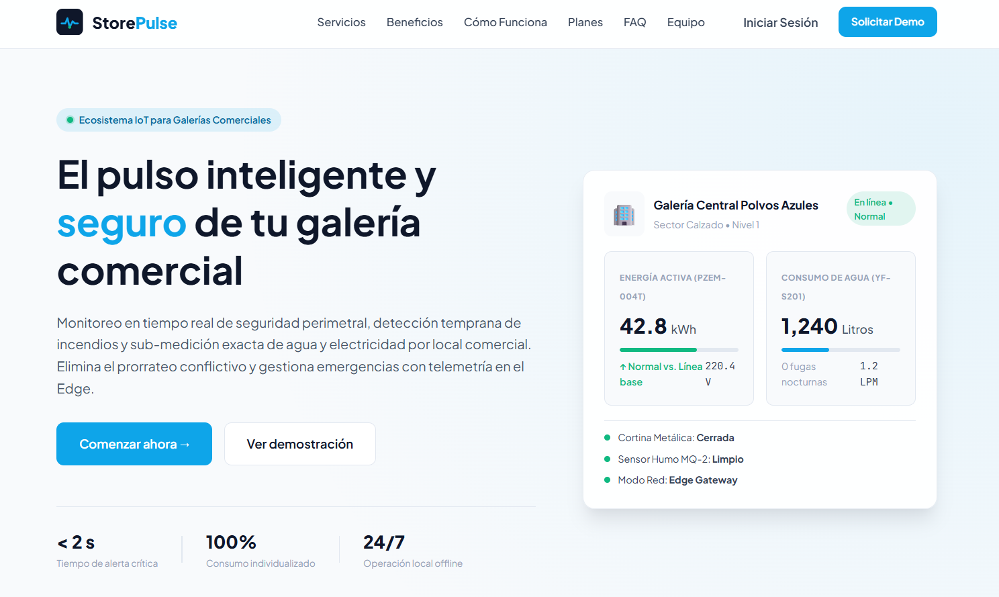

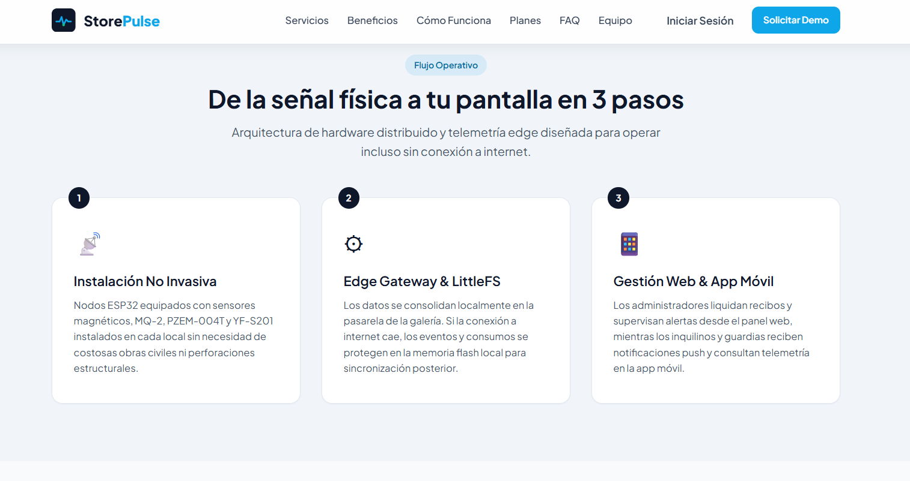

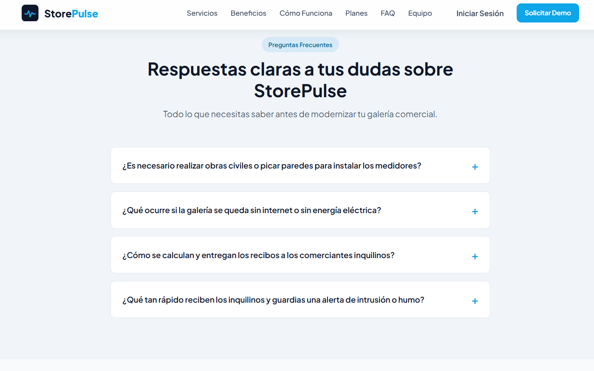

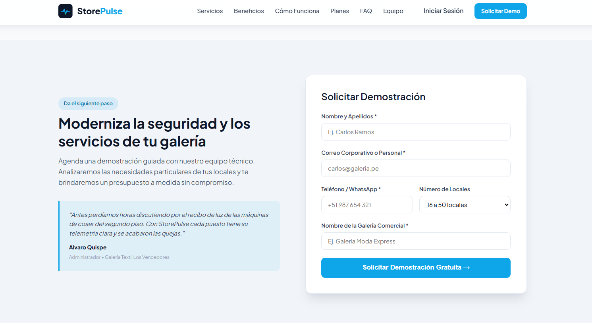

#### 6.2.1.7. Services Documentation Evidence for Sprint Review

Este sprint 1 solo trata la implementación del landing page, por lo
que no hay un servicio adicinal.

#### 6.2.1.8. Software Deployment Evidence for Sprint Review.

El despliegue del Landing Page se realizó a través de GitHub pages. El
link de nuestra Landing Page es el siguiente:

Link:
[<u>https://vanguardtechiot.github.io/storepulse-landing-page/</u>](https://vanguardtechiot.github.io/storepulse-landing-page/)

##### Despliegue del frontend web

Para publicar la aplicación, se configuró Firebase Hosting en el proyecto de Firebase `storepulse-web-app` y se utilizó Firebase CLI desde la carpeta del proyecto frontend. La aplicación se compiló para producción y los archivos generados se publicaron en Firebase Hosting.

El proceso realizado fue el siguiente:

1. Se instaló y utilizó Firebase CLI para administrar el despliegue desde la terminal.
2. Se inició sesión en Firebase CLI con una cuenta autorizada.
3. Se inicializó Firebase Hosting en el proyecto local y se guardó su configuración.
4. Se generó la compilación de producción de la aplicación Angular.
5. Se ejecutó `firebase deploy --only hosting` para publicar los archivos compilados.
6. Se verificó la finalización del despliegue y se abrió la URL pública para comprobar el acceso al frontend.

link:
[<u>https://storepulse-web-app.web.app</u>](https://storepulse-web-app.web.app)

##### Evidencias del proceso de despliegue

La Figura 1 muestra la pantalla de configuración de Firebase Hosting, donde se indican los pasos para instalar Firebase CLI e inicializar el proyecto.

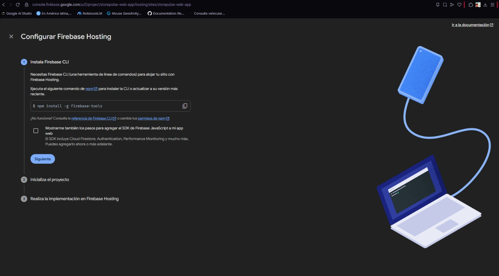

La Figura 2 presenta la terminal del entorno de desarrollo durante la autenticación y la inicialización de Firebase en el proyecto local.

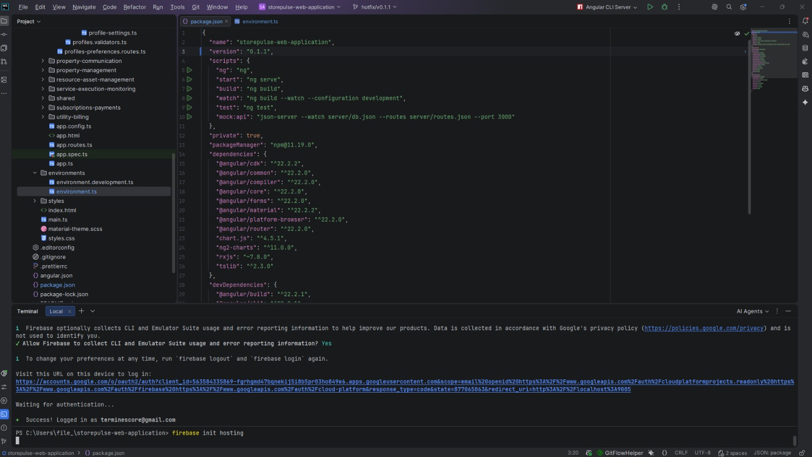

La Figura 3 muestra la ejecución del comando de despliegue y el resultado exitoso reportado por Firebase CLI. La salida identifica el sitio `storepulse-web-app` y la URL pública de Hosting.

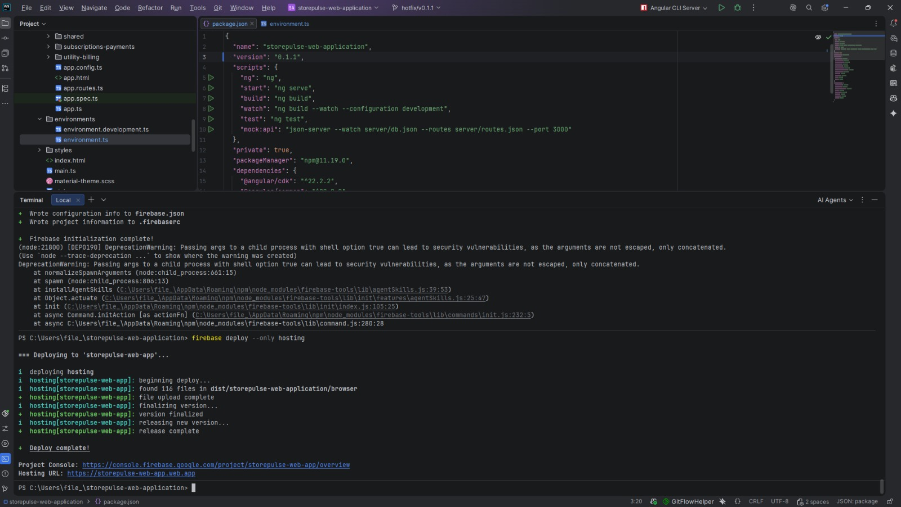

La Figura 4 presenta el panel de Firebase Hosting con la versión publicada y los dominios asociados al sitio.


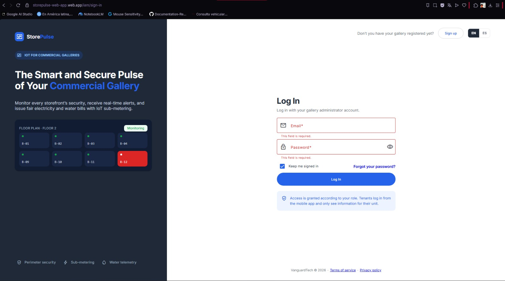

##### Verificación del frontend publicado

Después de completar el despliegue, se accedió a la aplicación mediante la URL pública `https://storepulse-web-app.web.app`. La Figura 5 muestra la pantalla de inicio de sesión cargada en el navegador, lo que permite comprobar que la ruta de acceso al frontend está disponible.

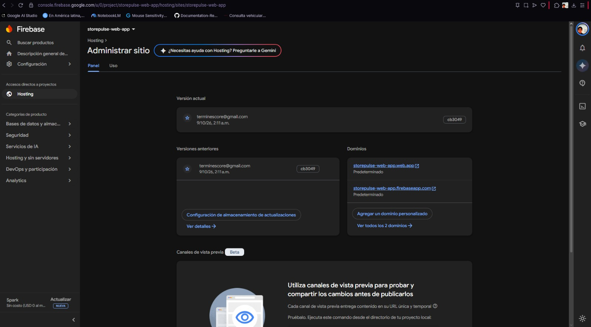

La Figura 6 corresponde al apartado de uso de Firebase Hosting. En la captura no se muestran datos de consumo en el periodo consultado; por ello, se incluye como referencia del panel de administración y no como evidencia de tráfico o uso efectivo por parte de usuarios.

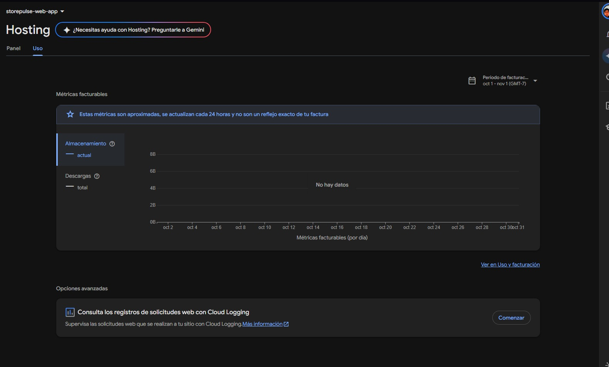

Finalmente, la Figura 7 muestra el dashboard de StorePulse cargado en el navegador. Esta captura evidencia la disponibilidad visual de la interfaz principal publicada, con sus módulos de navegación, indicadores y panel de consumo.

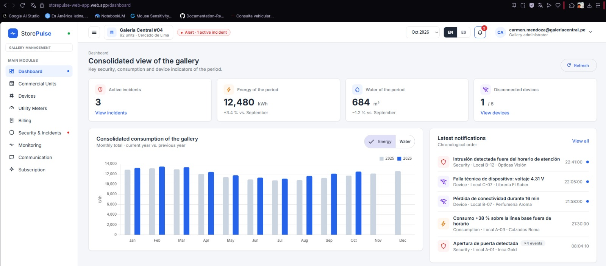


#### 6.2.1.9. Team Collaboration Insights during Sprint.

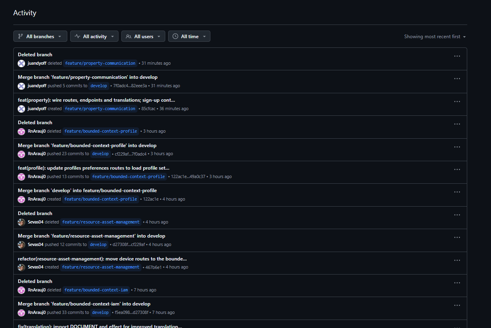

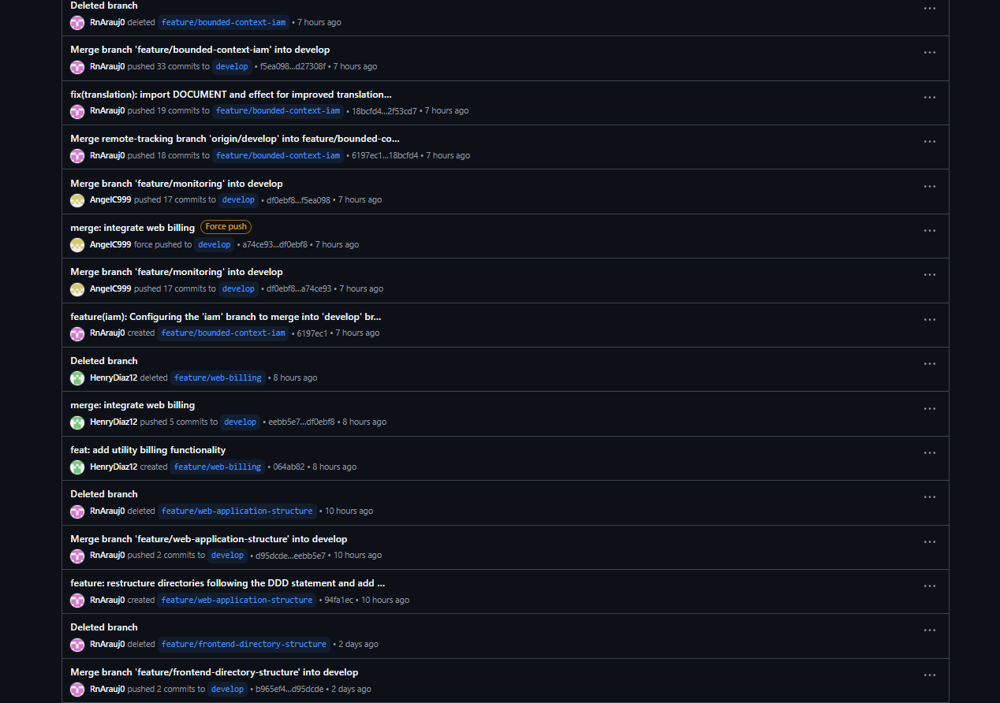

## 6.2.2. Sprint 2

### 6.2.2.1. Sprint Planning 2

| Aspecto | Detalle |
| :--- | :--- |
| **Sprint** | Sprint 2 |
| **Período** | 20/10/2026 – 15/11/2026 |
| **Objetivo del Sprint (Sprint Goal)** | Implementar, integrar y desplegar de extremo a extremo la plataforma central **StorePulse Platform** (Spring Boot 4 / Java 21 / MySQL), la pasarela IoT local **StorePulse Edge** (Python / Flask / SQLite con buffering offline y analítica local), la aplicación web del administrador **StorePulse Web Application** (Angular 22 conectada a la API real en Railway, retirando `json-server`), la aplicación móvil multirol **StorePulse Mobile** (Flutter para inquilinos y administradores) y la versión `2.1.0` de **StorePulse Landing Page**, respaldado por suites de pruebas automatizadas. |
| **Historias y Tareas Planificadas** | • **IAM, Perfiles y Acceso por Rol:** `US-01`, `US-02`, `US-03`, `US-04`, `US-05`, `US-06`, `US-07`, `TS-01`, `TS-02`, `TS-03`, `TS-04` <br> • **Propiedad, Locales e Invitaciones:** `US-08`, `US-09`, `US-10`, `US-11`, `US-12`, `US-13`, `US-57`, `TS-05`, `TS-06`, `TS-07`, `TS-08`, `TS-09`, `TS-10` <br> • **Activos IoT, Monitoreo, Seguridad y Continuidad Edge:** `US-14`, `US-15`, `US-16`, `US-17`, `US-18`, `US-19`, `US-20`, `US-21`, `US-23`, `US-24`, `US-26`, `US-27`, `US-28`, `US-29`, `US-30`, `US-39`, `US-40`, `US-41`, `US-42`, `US-50`, `US-51`, `US-53`, `US-59`, `TS-11`, `TS-12`, `TS-13`, `TS-14`, `TS-15`, `TS-16`, `TS-17`, `TS-19`, `TS-20`, `TS-22`, `TS-24`, `TS-25`, `TS-26`, `TS-30`, `TS-31`, `MS-01`, `MS-02`, `MS-03`, `MS-07`, `MS-08`, `MS-09` <br> • **Facturación, Reclamos y Comunicación:** `US-31`, `US-32`, `US-33`, `US-34`, `US-35`, `US-36`, `US-37`, `US-38`, `US-49`, `TS-21`, `TS-23` <br> • **Suscripciones y Pagos:** `US-44`, `US-45`, `US-46`, `US-47`, `US-48`, `TS-27`, `TS-28` <br> • **Landing Page (Conversión, Video y Legal):** `VS-06`, `VS-08`, `VS-09`, `VS-10` |
| **Entregables Esperados** | • REST API `storepulse-platform` (`v1.0.0`) desplegada en Railway con documentación Swagger/OpenAPI habilitada.<br>• Edge API `storepulse-edge` (`v1.0.1`) con IAM para dispositivos, persistencia local SQLite, evaluación de reglas de seguridad y módulo Edge Analytics.<br>• Aplicación web `storepulse-web-application` (`v2.0.0`) desplegada en Firebase Hosting consumiendo exclusivamente la REST API real.<br>• Aplicación móvil `storepulse-mobile` (`v1.0.1`) compilada para Android con flujos diferenciados para Administrador e Inquilino.<br>• Landing Page `storepulse-landing-page` (`v2.1.0`) actualizada en GitHub Pages con enlaces a producción, sección de video de producto y páginas legales.<br>• Suites de pruebas unitarias, integración y arquitectura ejecutadas en verde en los repositorios implementados. |

### 6.2.2.2. Aspect Leaders and Collaborators

En el Sprint 2 la matriz **LACX** (**L**: Leader, **A**: Accountable, **C**: Collaborator, **X**: Not involved / Informado) refleja la distribución real del equipo sobre los cinco productos implementados y el despliegue productivo:

| Aspecto / Contexto | Araujo Ingunza, Renzo José (`RnArauj0`) | Carranza Tesén, Joaquín Enrique (`thepima`) | Cordova Valdivia, Sebastián (`Sevas04`) | Curi Marcelo, Angelo Marcio (`AngeloC12`) | Diaz Gutierrez, Henry Kevin (`HenryDiaz12`) | Esquivel León, Miguel Juan Diego (`juandyoff`) |
| :--- | :---: | :---: | :---: | :---: | :---: | :---: |
| Gestión GitFlow, Releases y Despliegue Cloud | **L** | **A** | **C** | **C** | **C** | **C** |
| REST API (`storepulse-platform`): IAM, Profiles, Property & Assets | **A** | **L** | **C** | **C** | **C** | **C** |
| REST API (`storepulse-platform`): Monitoring, Safety, Dashboard, Billing & Subscriptions | **C** | **C** | **C** | **L** | **L** | **C** |
| Web Application (`storepulse-web-application`): Integración REST API y Vistas Admin | **A** | **L** | **X** | **C** | **X** | **C** |
| Edge API (`storepulse-edge`): Device IAM, Buffering SQLite, Safety & Analytics | **L** | **A** | **C** | **C** | **L** | **X** |
| Mobile Application (`storepulse-mobile`): Arquitectura Flutter, BLoC, Monitoreo y Suscripciones | **A** | **L** | **C** | **C** | **C** | **X** |
| Landing Page (`storepulse-landing-page`): Video, CTAs a Web App, i18n y Legal (`v2.1.0`) | **A** | **C** | **C** | **C** | **C** | **L** |

### 6.2.2.3. Sprint Backlog 2

La siguiente tabla detalla la descomposición en tareas de las historias abordadas durante el **Sprint 2** a lo largo de la REST API, la Web Application, el Edge Gateway, la Mobile Application y la evolución del Landing Page:

| Story Id | Story Title | Task Id | Task Title | Task Description | Estimation (Hours) | Assigned To | Status |
| :--- | :--- | :--- | :--- | :--- | :--- | :--- | :--- |
| US-01, US-02, TS-01, TS-02 | Registro, inicio de sesión y autenticación JWT | T2-01 | Implementar IAM Context y filtros JWT en Spring Boot | Desarrollar controladores `/authentication` y `/users/me`, emisión/validación de JWT y reglas `WebSecurityConfiguration`. | 8 | Carranza Tesén, Joaquín Enrique | DONE |
| US-03, US-04, TS-03 | Recuperación de contraseña y cierre de sesión | T2-02 | Implementar flujo de recuperación y sign-out en Backend y Mobile | Exponer `/password-recoveries` y `/reset` con entrega de códigos y pantallas `ForgotPasswordPage` / `ResetPasswordPage` en Flutter. | 6 | Araujo Ingunza, Renzo José | DONE |
| US-05, US-06, US-07, TS-04 | Control de acceso por rol y perfil de usuario | T2-03 | Integrar Profiles Context y aislamiento por rol | Implementar `/users/{userId}/profile` en Platform, store Angular de perfiles y pantallas `ProfilePage` / `SessionViewModel` en Mobile. | 6 | Carranza Tesén, Joaquín Enrique | DONE |
| US-08–US-13, US-57, TS-05–TS-10 | Gestión de galería, locales, áreas comunes e invitaciones | T2-04 | Implementar Property Management Context e invitaciones por token | Construir agregados `CommercialGallery`, `CommercialUnit` y `TenantInvitation`, endpoints REST y layouts compartidos en Web App. | 10 | Carranza Tesén, Joaquín Enrique | DONE |
| US-34, US-35, US-49, TS-23 | Comunicación, notificaciones y asignaciones | T2-05 | Implementar Property Communication Context y pruebas unitarias | Desarrollar `ConversationsController`, `TenantNotificationsController`, `TenantAssignmentsController` y pruebas de dominio/controlador. | 8 | Esquivel León, Miguel Juan Diego | DONE |
| US-14–US-18, TS-11–TS-14, MS-01–MS-03 | Registro, estado y salud técnica de dispositivos IoT | T2-06 | Implementar Resource & Asset Management Context y Device IAM en Edge | Exponer `/resources` e `/iot-devices` en Platform y registro/rotación/revocación de `X-API-Key` en `storepulse-edge`. | 8 | Cordova Valdivia, Sebastián | DONE |
| US-19–US-21, US-28–US-30, US-50–US-53, US-59, TS-15–TS-20, TS-22, TS-30, TS-31 | Monitoreo, reglas de seguridad, alertas y dashboard | T2-07 | Implementar Monitoring, Safety y Dashboard Analytics | Construir ingestión de telemetría, evaluación de reglas, ciclo `acknowledge`/`resolve` de alertas, resumen `/dashboard/summary` y notificación al inquilino. | 10 | Curi Marcelo, Angelo Marcio | DONE |
| US-39–US-42, TS-24–TS-26, MS-07–MS-09 | Continuidad operativa offline y Edge Analytics | T2-08 | Desarrollar buffering SQLite, sincronización y Edge Analytics | Implementar persistencia local en SQLite, reenvío de `supplyVoltage` y `bufferedEvents`, ACL `AnalyticsContextFacade`, endpoints locales y pruebas API. | 10 | Diaz Gutierrez, Henry Kevin | DONE |
| US-31–US-33, US-36–US-38, TS-21 | Facturación verificable y reclamos de servicios | T2-09 | Implementar Utility Billing Context y disputas de facturación | Desarrollar generación, verificación y emisión de facturas (`/utility-bills`) y flujo de reclamos (`/billing-disputes`) junto con su integración Angular. | 8 | Diaz Gutierrez, Henry Kevin | DONE |
| US-44–US-48, TS-27, TS-28 | Suscripciones, planes y pagos de galería | T2-10 | Implementar Subscriptions & Payments en Backend, Web y Mobile | Exponer `/subscription-plans` y `/subscriptions`, checkout/renovación y formateo de planes y cobertura IoT en Flutter (`SubscriptionCheckoutPage`). | 8 | Araujo Ingunza, Renzo José | DONE |
| US-02, US-19, US-50, US-51 | Integración completa Web & Mobile contra Backend Railway | T2-11 | Retirar API simulada y conectar clientes web/móvil a Railway | Actualizar `environment.ts` en Angular, eliminar `json-server`, configurar `ApiConfig.baseUrl` en Flutter y validar flujos en producción. | 8 | Carranza Tesén, Joaquín Enrique | DONE |
| VS-06, VS-08, VS-09, VS-10 | Video de producto, CTAs a Web App, i18n y términos en Landing Page | T2-12 | Actualizar Landing Page (`v2.1.0`) y publicar en GitHub Pages | Incorporar sección de video de producto, enlazar CTAs hacia `storepulse-web-app.web.app`, completar textos EN/ES y ajustar diseño responsive. | 6 | Esquivel León, Miguel Juan Diego | DONE |

> **Agregar imagen referente a:** Tablero Trello con el Sprint Backlog 2 organizado en columnas To Do, In Progress y Done reflejando las historias y tareas del Sprint 2.

### 6.2.2.4. Development Evidence for Sprint Review

Durante el **Sprint 2** el trabajo colaborativo bajo GitFlow se distribuyó en seis repositorios activos dentro de la organización `VanguardTechIot`:

| Repository | URL | Main Branches Used in Sprint 2 |
| :--- | :--- | :--- |
| `storepulse-platform` | https://github.com/VanguardTechIot/storepulse-platform | `main` (`1.0.0`), `develop`, `release/1.0.0`, `feature/*` |
| `storepulse-web-application` | https://github.com/VanguardTechIot/storepulse-web-application | `main` (`2.0.0`), `develop`, `release/2.0.0`, `feature/*` |
| `storepulse-edge` | https://github.com/VanguardTechIot/storepulse-edge | `main` (`1.0.1`), `develop`, `release/1.0.0`, `release/1.0.1`, `feature/*` |
| `storepulse-mobile` | https://github.com/VanguardTechIot/storepulse-mobile | `main` (`1.0.1`), `develop`, `release/1.0.0`, `release/1.0.1`, `feature/*` |
| `storepulse-landing-page` | https://github.com/VanguardTechIot/storepulse-landing-page | `main` (`2.1.0`), `develop`, `release/2.1.0`, `feature/*` |
| `storepulse-report` | https://github.com/VanguardTechIot/storepulse-report | `main` (`v2.1.0`), `develop`, `feature/*` |

La siguiente tabla reúne una muestra representativa de *commits* verificados en los repositorios durante el Sprint 2 (siguiendo Conventional Commits y flujo de ramas GitFlow):

| Repository | Branch | Commit Id | Commit Message | Commit Message Body | Commited on (Date) |
| :--- | :--- | :--- | :--- | :--- | :--- |
| `storepulse-platform` | `develop` | `db6a35feabacc6e963e635228b9bc7190e5cecff` | `feat(config): enable demo data in application properties` | — | 2026-11-10 |
| `storepulse-platform` | `develop` | `f6469a08f20669120dd3dfe99816deae30be9e17` | `feat(shared): load the demo gallery on the first start` | — | 2026-11-09 |
| `storepulse-platform` | `develop` | `ecbbf9ce6a371742e9dcdd491bc2bb8c362493c1` | `feat(billing): implement billing dispute command service` | — | 2026-11-06 |
| `storepulse-platform` | `develop` | `0e91e8b1770b3ca85bda35a44ef60c409f667e21` | `feat(safety): notify tenant of new alerts` | — | 2026-11-10 |
| `storepulse-platform` | `develop` | `0e8aa64d98c219f8ad9c63c0a1671ff843cccf1e` | `test(assets): cover the activation, connectivity and fault rules of IoT devices` | — | 2026-11-09 |
| `storepulse-platform` | `develop` | `11e0765f67a7ca2e5cb8de56034bb11aa96bbef1` | `test(property-communication): cover conversation and notification rules, tenant assignment and the conversations controller` | — | 2026-11-07 |
| `storepulse-web-application` | `develop` | `be3a1ff118d0bb6cb35946561396290bd1e8114c` | `refactor(environment): update API base URL to reflect deployment on Railway` | — | 2026-11-10 |
| `storepulse-web-application` | `develop` | `6e807a1f39a61b36834d628cae1baa3c29f10c4c` | `feat(iam): sign in and sign up against the authentication api` | — | 2026-11-09 |
| `storepulse-web-application` | `develop` | `4da288b26b92d1439c4d85ce40fee7aa471cc5d1` | `chore: remove the local json api` | — | 2026-11-09 |
| `storepulse-web-application` | `develop` | `c879b0b82cd91a3f8ad134d08629c08c4ff6cd99` | `refactor(monitoring): remove code comments` | — | 2026-11-10 |
| `storepulse-web-application` | `develop` | `2993716570a00d65b0616c79d62149615809b7bd` | `style(property): share the page layout of Property Management and Property Communication and use the theme tokens` | — | 2026-11-07 |
| `storepulse-edge` | `develop` | `d4034ca8b3b8072e0795fb68113bcf974ae06ca0` | `feat(iam): add docstrings for IAM bounded context interfaces and error handlers` | — | 2026-11-12 |
| `storepulse-edge` | `develop` | `7bd57b9cb7cb22af6abfb136af7f60e61b7084ce` | `feat(analytics): add Flask REST blueprint for overview, device stats and notifications` | — | 2026-11-15 |
| `storepulse-edge` | `develop` | `4781948db6a5f781f24612f6afb113e62c8c2479` | `test(analytics): add end-to-end API integration tests for analytics blueprint` | — | 2026-11-15 |
| `storepulse-edge` | `develop` | `3e748af51b76e07248b4bbbc27f6896c097de67c` | `test(analytics): add unit and SQLite persistence tests for domain, services and facade` | — | 2026-11-15 |
| `storepulse-edge` | `develop` | `37178e2cbe3b9a608cb2af7b666d5cb7b60c93b6` | `fix(monitoring): add missing telemetry columns on start` | — | 2026-11-13 |
| `storepulse-edge` | `develop` | `665ccc7cb768f429a154ea6accd949ca9a90dc79` | `feat(monitoring): send the supply voltage and buffered events to the platform` | — | 2026-11-12 |
| `storepulse-mobile` | `develop` | `f41432999970871e515e6075986b9c6d9c17fa5b` | `feat(main): integrate session management with Bloc and update navigation` | — | 2026-11-12 |
| `storepulse-mobile` | `develop` | `24b645e88e970315122d16757ca160b773a90d23` | `docs(readme): describe mobile architecture, setup, features and routes` | — | 2026-11-15 |
| `storepulse-mobile` | `develop` | `7b5237e170e6930b7bbe9e6b269170ae80a980af` | `fix(subscriptions): format English feature keys, plan names, and statuses for UI` | — | 2026-11-14 |
| `storepulse-mobile` | `develop` | `f477ecfdf24964ddff21fe91f83abc43222d8bce` | `feat(main): add monitoring tab` | — | 2026-11-10 |
| `storepulse-mobile` | `develop` | `f5ac41de77069facca57f3f51af5ba85caca3c4f` | `feat(core): use the deployed platform as the default api` | — | 2026-11-13 |
| `storepulse-landing-page` | `develop` | `33596292093030e01a892698cc2731d32ca9ef34` | `feat(i18n): update default language to English and improve language switch functionality` | — | 2026-10-20 |
| `storepulse-landing-page` | `develop` | `f5537ddf0ffc5d743ce7b3ff0c848a66925c137a` | `refactor(landing): replace demo cta, fix footer links, and improve navbar responsiveness` | — | 2026-11-15 |
| `storepulse-landing-page` | `develop` | `6b8d4d974a004d40d0b5b809ba8ebc364a598e37` | `feat(landing): link the get started button to the web app sign up` | — | 2026-11-10 |
| `storepulse-landing-page` | `develop` | `a73823d7e2930b68242bcf66998e032ba4f0fa6b` | `feat(landing): add the product video section and link the watch demo button to it` | — | 2026-11-10 |
| `storepulse-landing-page` | `develop` | `d0c7f31efb43ff922a96aa7cbd6957dad23153a3` | `fix(landing): link navbar login to web app` | — | 2026-10-20 |
| `storepulse-landing-page` | `develop` | `eca8548ff1dd97d8d340dcdff2528dedc0a27bd8` | `refactor(landing): simplify footer and metadata wording` | — | 2026-10-20 |

### 6.2.2.5. Testing Suite Evidence for Sprint Review

A diferencia del Sprint 1, el **Sprint 2** ejecuta suites de pruebas automatizadas sobre los cuatro repositorios de aplicación y servicio:

| Repositorio | Framework de Pruebas | Alcance Verificado | Resultado de Ejecución |
| :--- | :--- | :--- | :--- |
| `storepulse-platform` | JUnit 5, Mockito, Spring Boot MockMvc y ArchUnit (`./mvnw test`) | 32 clases de prueba que cubren reglas de dominio, servicios de aplicación, ACL, controladores REST, arranque del contexto Spring Boot y arquitectura hexagonal/DDD por Bounded Context (`ArchitectureTest`). | **106 pruebas ejecutadas, 0 fallos, 0 errores, 0 omitidas (`BUILD SUCCESS`)** |
| `storepulse-web-application` | Vitest 5 (`ng test --watch=false`) | 24 archivos `.spec.ts` sobre entidades, *value objects*, *stores* con señales, interceptor IAM, manejo de errores API (`toApiError`) y componente raíz `App`. | **24 archivos de prueba, 86 pruebas aprobadas** |
| `storepulse-edge` | `unittest` de Python + cliente Flask de pruebas + SQLite temporal | Pruebas de dominio puro (`TelemetryAnalyticsService`), persistencia/servicios/fachada ACL en SQLite y flujo HTTP de extremo a extremo IAM → Monitoring → Safety → Analytics. | **6 pruebas ejecutadas, OK (0 fallos)** |
| `storepulse-mobile` | `flutter_test` | Pruebas unitarias de dominio (`iam`, `profiles_preferences`), aislamiento de consultas por rol en `SubscriptionViewModel` (`TENANT` vs `GALLERY_ADMINISTRATOR`) y pruebas de widgets (`IamHeader`, `StorePulseApp`). | **13 pruebas aprobadas (4 archivos `.dart`)** |

La siguiente tabla resume los casos de prueba representativos verificados por producto y Bounded Context durante el Sprint 2:

| Test Id | Tipo | Archivo | Related Story | Escenario de aceptación / Verificación | Status |
| :--- | :--- | :--- | :--- | :--- | :--- |
| TS2-01 | Arquitectura / DDD | `storepulse-platform/.../ArchitectureTest.java` | TS-01 – TS-28 | Verifica aislamiento del dominio y comunicación exclusiva entre Bounded Contexts vía fachadas `interfaces.acl` (4 reglas ArchUnit). | PASSED |
| TS2-02 | Unitaria (Dominio) | `storepulse-platform/.../assets/.../IoTDeviceTest.java` | US-15, US-16, US-17, US-18 | Valida componentes por tipo de nodo, activación/desactivación, fallas de voltaje fuera de 4.5–5.5 V y pérdida de conectividad (11 casos). | PASSED |
| TS2-03 | Integración REST | `storepulse-platform/.../monitoring/.../TelemetryControllerTest.java` | TS-15, TS-19 | Comprueba recepción y consulta de telemetría HTTP en `/api/v1/telemetry` con validación de visibilidad por usuario. | PASSED |
| TS2-04 | Unitaria (Dominio) | `storepulse-platform/.../safety/.../AlertTest.java` | US-20, US-21, US-53, TS-16 | Valida transiciones de estado de alerta (`ACTIVE` → `ACKNOWLEDGED` → `RESOLVED`) y generación ante mediciones fuera de umbral. | PASSED |
| TS2-05 | Integración REST | `storepulse-platform/.../dashboardanalytics/.../DashboardControllerTest.java` | US-50, TS-31 | Verifica el endpoint `/api/v1/dashboard/summary` consolidando métricas de alertas activas y consumo mensual. | PASSED |
| TS2-06 | Integración REST | `storepulse-platform/.../propertycommunication/.../ConversationsControllerTest.java` | US-34, US-35, TS-23 | Valida creación de conversaciones, envío de mensajes con adjuntos y resolución por parte del administrador. | PASSED |
| TS2-07 | Integración REST | `storepulse-platform/.../subscriptionspayments/.../SubscriptionsControllerTest.java` | US-44, US-46, US-47 | Comprueba contratación de suscripción, cancelación/reactivación de renovación y consulta de historial de pagos. | PASSED |
| TS2-08 | Integración REST | `storepulse-platform/.../utilitybilling/.../UtilityBillsControllerTest.java` y `BillingDisputesControllerTest.java` | US-32, US-37, US-38, TS-21 | Valida ciclo de factura (`DRAFT` → `VERIFIED` → `ISSUED`) y apertura/revisión/resolución de reclamos. | PASSED |
| TS2-09 | Unitaria (Frontend) | `storepulse-web-application/.../commercial-unit.entity.spec.ts` y `tenant-invitation.entity.spec.ts` | US-09, US-11, US-12 | Valida reglas de unidades comerciales, códigos únicos, baja condicionada y expiración/revocación de invitaciones (10 casos). | PASSED |
| TS2-10 | Unitaria (Frontend) | `storepulse-web-application/.../utility-bill.entity.spec.ts` y `utility-billing.store.spec.ts` | US-30, US-32, TS-22 | Comprueba detección de desvíos > 20 % respecto a línea base histórica y flujo del store de facturación (9 casos). | PASSED |
| TS2-11 | Unitaria / HTTP (Frontend) | `storepulse-web-application/.../iam.interceptor.spec.ts` | US-02, US-05, TS-01 | Verifica inyección automática de `Authorization: Bearer <token>` y cierre de sesión ante respuestas HTTP `401`. | PASSED |
| TS2-12 | Integración End-to-End (Edge) | `storepulse-edge/test/test_analytics_api.py` | TS-25, TS-26, MS-02, MS-07 | Simula flujo completo: registro de dispositivo (`201`), ingesta de telemetría con caída de backend (`202` en cola), cálculo de batería baja (`3.1 V`) y notificación local en `/api/v1/analytics/notifications`. | PASSED |
| TS2-13 | Unitaria / SQLite (Edge) | `storepulse-edge/test/test_analytics_domain_and_application.py` | TS-22, US-41, MS-09 | Verifica clasificación de alimentación (red eléctrica vs batería 18650), detección de anomalías tras línea base y consolidación de alertas en ventana de 5 minutos (5 casos). | PASSED |
| TS2-14 | Unitaria / Widget (Mobile) | `storepulse-mobile/test/iam_profiles_domain_test.dart`, `subscription_view_model_test.dart`, `iam_header_test.dart`, `widget_test.dart` | US-01–US-07, US-45 | Valida reglas IAM/Profiles, separación de vistas por rol (`TENANT` sin llamadas exclusivas de administrador) y renderizado inicial de `StorePulseApp` (13 casos). | PASSED |

#### 6.2.2.6. Execution Evidence for Sprint Review

Durante la Sprint Review del **Sprint 2** se demostró el funcionamiento integrado de toda la solución:

1. **REST API (`storepulse-platform`)**: Arranque en producción en Railway conectado a MySQL con carga inicial de datos demostrativos, emisión de tokens JWT, gestión de galería/unidades, recepción de telemetría desde el Edge, escalamiento automático de alertas y emisión de recibos/suscripciones.
2. **Edge Gateway (`storepulse-edge`)**: Recepción autenticada (`X-API-Key`) de paquetes enviados por nodos ESP32, evaluación local inmediata de reglas de seguridad, almacenamiento en buffer SQLite ante ausencia de red y sincronización periódica hacia la nube junto con exposición del resumen analítico local.
3. **Web Application (`storepulse-web-application`)**: Flujo completo del **Administrador de Galería** desde la interfaz Angular conectada a Railway: autenticación, panel consolidado (`Dashboard`), gestión de locales/áreas comunes e invitaciones por enlace, monitoreo de dispositivos IoT, centro de alertas, facturación con desglose, reclamos, conversaciones y suscripciones.
4. **Mobile Application (`storepulse-mobile`)**: Flujo multirol en Android (**Administrador** e **Inquilino**) con inicio/cierre de sesión persistido, dashboard de seguridad y consumo en tiempo real, monitoreo de sensores por local, visualización de cobertura/suscripción y gestión de perfil.
5. **Landing Page (`storepulse-landing-page` `v2.1.0`)**: Visualización del video de presentación del producto, navegación directa a registro/inicio de sesión en la aplicación web desplegada, cambio de idioma EN/ES y páginas legales.

> **Agregar imagen referente a:** Captura de ejecución del Backend / Swagger UI mostrando respuestas exitosas `200 OK` / `201 Created` de los endpoints principales de StorePulse Platform.

> **Agregar imagen referente a:** Captura de ejecución del Edge Gateway (`storepulse-edge`) en consola recibiendo telemetría IoT, guardando en SQLite y sincronizando con la plataforma.

> **Agregar imagen referente a:** Capturas de ejecución de la Web Application (`storepulse-web-application`) mostrando el Dashboard, Gestión de Locales/Dispositivos, Alertas y Facturación consumiendo la API en Railway.

> **Agregar imagen referente a:** Capturas de ejecución de la Mobile Application (`storepulse-mobile`) en emulador o dispositivo Android mostrando Inicio de Sesión, Dashboard del Local, Monitoreo de Sensores y Suscripción/Perfil.

> **Agregar imagen referente a:** Captura de ejecución del Landing Page (`v2.1.0`) mostrando la sección de Video del Producto y enlaces activos hacia la Web App.

#### 6.2.2.7. Services Documentation Evidence for Sprint Review

En esta sección del informe se presentan los principales endpoints desarrollados en el backend del proyecto (`storepulse-platform`) y en la pasarela local (`storepulse-edge`), detallando las funcionalidades implementadas durante el Sprint 2.

**Backend Desplegado**

[Ver Swagger API Documentation](https://storepulse-platform-production.up.railway.app/swagger-ui.html)

## Authentication & Users Services (`storepulse-platform`)

| Método | Endpoint | Función |
|---|---|---|
| POST | **/api/v1/authentication/sign-up** | Permite registrar nuevos usuarios en la plataforma (`GALLERY_ADMINISTRATOR` / `TENANT`). |
| POST | **/api/v1/authentication/sign-in** | Permite iniciar sesión y generar el token JWT de autenticación. |
| POST | **/api/v1/authentication/sign-out** | Cierra la sesión activa del usuario autenticado. |
| POST | **/api/v1/password-recoveries** | Solicita el código temporal de recuperación de contraseña por correo electrónico. |
| POST | **/api/v1/password-recoveries/reset** | Restablece la contraseña validando el código temporal recibido. |
| GET | **/api/v1/users/me** | Obtiene los datos de la cuenta del usuario autenticado actual. |

---

## Profiles & Preferences Services (`storepulse-platform`)

| Método | Endpoint | Función |
|---|---|---|
| GET | **/api/v1/users/{userId}/profile** | Obtiene la información del perfil asociada al usuario indicado. |
| PUT | **/api/v1/users/{userId}/profile** | Permite actualizar los datos personales, contacto y foto del perfil del usuario. |

---

## Property Management Services (`storepulse-platform`)

| Método | Endpoint | Función |
|---|---|---|
| GET | **/api/v1/galleries** | Lista las galerías comerciales del administrador consultado (`administratorId`). |
| GET | **/api/v1/galleries/{galleryId}** | Obtiene la información detallada de una galería comercial mediante su Id. |
| POST | **/api/v1/galleries** | Registra una nueva galería comercial para el administrador autenticado. |
| PUT | **/api/v1/galleries/{galleryId}** | Actualiza el nombre, dirección y total de locales de la galería. |
| GET | **/api/v1/galleries/{galleryId}/units** | Lista los locales (`STORE`) y áreas comunes (`COMMON_AREA`) registrados en una galería. |
| POST | **/api/v1/galleries/{galleryId}/units** | Registra un nuevo local o área común dentro de la galería. |
| GET | **/api/v1/units/{unitId}** | Obtiene la información detallada de un local o área común mediante su Id. |
| PATCH | **/api/v1/units/{unitId}** | Actualiza datos, estado operativo (`AVAILABLE`, `OCCUPIED`, `MAINTENANCE`) o baja lógica de la unidad. |
| POST | **/api/v1/units/{unitId}/invite** | Envía una invitación de vinculación por correo al inquilino de un local disponible. |
| GET | **/api/v1/tenant-invitations** | Lista las invitaciones emitidas en la galería (`galleryId`), de la más reciente a la más antigua. |
| GET | **/api/v1/tenant-invitations/by-token/{token}** | Consulta el detalle de una invitación pendiente a partir de su token de enlace. |
| POST | **/api/v1/tenant-invitations/accept** | Permite al inquilino autenticado aceptar una invitación usando su token de enlace. |
| PATCH | **/api/v1/tenant-invitations/{invitationId}/revoke** | Revoca una invitación pendiente emitida por la administración de la galería. |

---

## Property Communication Services (`storepulse-platform`)

| Método | Endpoint | Función |
|---|---|---|
| GET | **/api/v1/conversations** | Obtiene las conversaciones del usuario autenticado, ordenadas de la más reciente a la más antigua. |
| GET | **/api/v1/conversations/{conversationId}** | Obtiene el detalle de una conversación específica del usuario autenticado. |
| POST | **/api/v1/conversations** | Inicia una nueva conversación asociada a un local activo del inquilino. |
| PATCH | **/api/v1/conversations/{conversationId}/resolve** | Marca una conversación del administrador como resuelta. |
| GET | **/api/v1/conversations/{conversationId}/messages** | Lista los mensajes de una conversación del usuario autenticado. |
| POST | **/api/v1/conversations/{conversationId}/messages** | Envía un nuevo mensaje con archivos adjuntos opcionales dentro de la conversación. |
| GET | **/api/v1/tenant-notifications** | Obtiene las notificaciones enviadas por el administrador o recibidas por el inquilino. |
| POST | **/api/v1/tenant-notifications** | Envía una notificación directa a un inquilino de la galería. |
| POST | **/api/v1/tenant-notifications/announcements** | Publica un comunicado o aviso de incidente a los inquilinos de los locales seleccionados. |
| PATCH | **/api/v1/tenant-notifications/{notificationId}/retry** | Reintenta el envío de una notificación fallida. |
| PATCH | **/api/v1/tenant-notifications/{notificationId}/read** | Marca una notificación recibida por el inquilino como leída. |
| GET | **/api/v1/communication-logs** | Lista los registros de trazabilidad de comunicaciones del administrador. |
| POST | **/api/v1/communication-logs** | Registra una nueva entrada en el historial de comunicaciones. |
| GET | **/api/v1/tenant-assignments** | Lista las asignaciones activas o históricas de inquilinos visibles para el usuario. |
| POST | **/api/v1/tenant-assignments** | Asigna directamente un inquilino registrado a un local disponible de la galería. |
| PATCH | **/api/v1/tenant-assignments/{assignmentId}/terminate** | Finaliza una asignación activa y libera el local correspondiente. |

---

## Resource & Asset Management Services (`storepulse-platform`)

| Método | Endpoint | Función |
|---|---|---|
| GET | **/api/v1/resources** | Obtiene el catálogo de recursos monitoreados (stands y áreas comunes) vinculables a unidades de la galería. |
| GET | **/api/v1/iot-devices** | Lista los dispositivos IoT instalados en los recursos de la galería del administrador. |
| GET | **/api/v1/iot-devices/{iotDeviceId}** | Obtiene el detalle de un dispositivo IoT específico mediante su Id. |
| POST | **/api/v1/iot-devices** | Registra e instala un dispositivo IoT asociado a un recurso de la galería. |
| PATCH | **/api/v1/iot-devices/{iotDeviceId}/deactivation** | Desactiva temporalmente la recepción de datos de un dispositivo (p. ej. mantenimiento). |
| PATCH | **/api/v1/iot-devices/{iotDeviceId}/reactivation** | Reactiva un dispositivo previamente desactivado para reanudar su monitoreo. |

---

## Service Execution & Monitoring Services (`storepulse-platform`)

| Método | Endpoint | Función |
|---|---|---|
| POST | **/api/v1/telemetry** | Registra paquetes de telemetría enviados por los dispositivos a través del Edge Gateway. |
| GET | **/api/v1/telemetry** | Consulta la telemetría de los dispositivos visibles para el usuario (`deviceId` opcional). |
| GET | **/api/v1/telemetry/{telemetryId}** | Obtiene el detalle de un registro de telemetría por su Id. |
| GET | **/api/v1/monitored-resources** | Lista los recursos monitoreados visibles para el usuario junto con sus dispositivos asociados. |
| GET | **/api/v1/sensors/status** | Obtiene la última lectura de cada sensor de un dispositivo o recurso (`deviceId` / `resourceId`). |
| GET | **/api/v1/consumption** | Obtiene el consumo acumulado por periodo de los recursos visibles (`resourceId` opcional). |

---

## Safety & Emergencies Services (`storepulse-platform`)

| Método | Endpoint | Función |
|---|---|---|
| GET | **/api/v1/alerts** | Lista las alertas generadas por los dispositivos visibles para el usuario, ordenadas por recencia. |
| GET | **/api/v1/alerts/{alertId}** | Obtiene el detalle de una alerta específica mediante su Id. |
| PATCH | **/api/v1/alerts/{alertId}/acknowledge** | Confirma que una alerta activa de la galería está siendo atendida. |
| PATCH | **/api/v1/alerts/{alertId}/resolve** | Resuelve una alerta confirmada registrando el resultado de la atención. |
| GET | **/api/v1/device-states** | Consulta el estado operativo/seguridad actual de un dispositivo visible (`deviceId`). |
| GET | **/api/v1/safety-rules** | Obtiene el catálogo completo de reglas de seguridad por tipo de sensor. |
| GET | **/api/v1/safety-rules/{safetyRuleId}** | Obtiene el detalle de una regla de seguridad específica por su Id. |

---

## Dashboard & Analytics Services (`storepulse-platform`)

| Método | Endpoint | Función |
|---|---|---|
| GET | **/api/v1/dashboard/summary** | Obtiene el resumen consolidado de alertas activas y consumo de energía y agua del mes actual. |

---

## Utility Billing & Disputes Services (`storepulse-platform`)

| Método | Endpoint | Función |
|---|---|---|
| GET | **/api/v1/utility-bills** | Lista los recibos de servicios visibles para el usuario (`unitId` opcional), del más reciente al más antiguo. |
| GET | **/api/v1/utility-bills/{utilityBillId}** | Obtiene el detalle y desglose verificable de un recibo mediante su Id. |
| POST | **/api/v1/utility-bills** | Genera un recibo en borrador (`DRAFT`) para un local comercial y periodo mensual determinado. |
| PATCH | **/api/v1/utility-bills/{utilityBillId}/verify-data** | Verifica las mediciones base de un recibo antes de su emisión. |
| PATCH | **/api/v1/utility-bills/{utilityBillId}/issue** | Emite formalmente un recibo verificado fijando su fecha de vencimiento y notificando al inquilino. |
| GET | **/api/v1/billing-disputes** | Lista los reclamos sobre recibos visibles para el usuario (`utilityBillId` opcional). |
| GET | **/api/v1/billing-disputes/{billingDisputeId}** | Obtiene el detalle de un reclamo de facturación mediante su Id. |
| POST | **/api/v1/billing-disputes** | Permite al inquilino autenticado registrar un reclamo sobre un recibo emitido. |
| PATCH | **/api/v1/billing-disputes/{billingDisputeId}/review** | Cambia el estado de un reclamo abierto a revisión por parte de la administración. |
| PATCH | **/api/v1/billing-disputes/{billingDisputeId}/resolve** | Resuelve un reclamo de facturación registrando la decisión administrativa. |

---

## Subscriptions & Payments Services (`storepulse-platform`)

| Método | Endpoint | Función |
|---|---|---|
| GET | **/api/v1/subscription-plans** | Obtiene el catálogo de planes de suscripción publicados en StorePulse. |
| GET | **/api/v1/subscriptions** | Obtiene la suscripción vigente de la galería consultada (`galleryId`). |
| POST | **/api/v1/subscriptions** | Contrata o actualiza el plan de suscripción de la galería procesando el pago asociado. |
| POST | **/api/v1/subscriptions/{subscriptionId}/cancel-renewal** | Cancela la renovación automática de la suscripción. |
| POST | **/api/v1/subscriptions/{subscriptionId}/reactivate-renewal** | Reactiva la renovación automática de la suscripción. |
| GET | **/api/v1/subscriptions/{subscriptionId}/payments** | Obtiene el historial de pagos asociados a una suscripción, del más reciente al más antiguo. |

---

## Edge Gateway Services (`storepulse-edge` — Gateway Local LAN)

El servicio Edge se ejecuta en la red local de la galería comercial (`http://0.0.0.0:5000/api/v1`) sobre Flask 3.1 y SQLite para garantizar operación continua y sincronización hacia la nube:

| Método | Endpoint | Función |
|---|---|---|
| POST | **/api/v1/iam/authentications** | Autentica un nodo ESP32 al iniciar mediante `device_id` y cabecera `X-API-Key`. |
| GET | **/api/v1/iam/devices** | Lista los dispositivos registrados en el Edge Gateway (requiere JWT de administrador). |
| POST | **/api/v1/iam/devices** | Registra un nodo IoT vinculado a `platform_device_id` y emite su `api_key`. |
| POST | **/api/v1/iam/devices/&lt;device_id&gt;/api-keys** | Rota la `api_key` de un dispositivo activo invalidando la clave anterior. |
| POST | **/api/v1/iam/devices/&lt;device_id&gt;/revocation** | Revoca permanentemente el acceso de un dispositivo en la pasarela local. |
| POST | **/api/v1/monitoring/telemetry** | Recibe mediciones, `supplyVoltage` y `bufferedEvents` (`X-API-Key`), evalúa reglas locales y sincroniza o encola (`201` / `202`). |
| GET | **/api/v1/monitoring/synchronization** | Devuelve el conteo de paquetes locales pendientes de sincronización con `storepulse-platform`. |
| GET | **/api/v1/safety/rules** | Lista las reglas de seguridad activas evaluadas localmente en el Edge Gateway. |
| GET | **/api/v1/analytics/overview** | Expone totales locales de telemetría, alertas activas/críticas y estado de batería de respaldo por galería. |
| GET | **/api/v1/analytics/devices/&lt;platform_device_id&gt;** | Devuelve agregaciones de sensores, estado de salud del nodo y alertas locales de un dispositivo. |
| GET | **/api/v1/analytics/notifications** | Lista las notificaciones locales consolidadas del Edge (filtrables por `status`, `category` y `platformDeviceId`). |
| POST | **/api/v1/analytics/notifications/&lt;notification_id&gt;/acknowledge** | Confirma la atención de una notificación local activa generada en el Edge Gateway. |

#### 6.2.2.8. Software Deployment Evidence for Sprint Review

Al cierre del **Sprint 2**, las aplicaciones y servicios de **StorePulse** se encuentran desplegados y accesibles según su entorno de ejecución:

| Producto | Plataforma / Entorno | Versión / Tag | Enlace de Despliegue / Artefacto |
| :--- | :--- | :--- | :--- |
| **StorePulse Platform (REST API)** | Railway (`storepulse-platform-production`) + Swagger UI | `1.0.0` | https://storepulse-platform-production.up.railway.app/api/v1 <br> Swagger: https://storepulse-platform-production.up.railway.app/swagger-ui.html |
| **StorePulse Web Application** | Firebase Hosting (`storepulse-web-app`) | `2.0.0` | https://storepulse-web-app.web.app (y https://storepulse-web-app.firebaseapp.com) |
| **StorePulse Landing Page** | GitHub Pages | `2.1.0` | https://vanguardtechiot.github.io/storepulse-landing-page/ |
| **StorePulse Mobile (Android)** | Firebase App Distribution (`storepulse-mobile`) | `1.0.0 (2)` | Distribución por invitación a los verificadores del equipo (APK Android) |
| **StorePulse Edge Gateway** | Entorno Local LAN en Gateway (`python main.py` + `storepulse_edge.db`) | `1.0.1` | https://github.com/VanguardTechIot/storepulse-edge/releases/tag/1.0.1 (`http://0.0.0.0:5000/api/v1`) |

##### Despliegue del backend (REST API) en Railway

El backend `storepulse-platform` se desplegó en Railway dentro del proyecto `enthusiastic-reprieve`, en el entorno `production`. Railway construye y publica el servicio automáticamente desde el repositorio de GitHub cada vez que se integra un cambio en la rama configurada, y lo conecta a una base de datos MySQL administrada en el mismo proyecto.

La Figura 8 muestra la vista general del proyecto en Railway, con el servicio `storepulse-platform` y la base de datos `MySQL` (con su volumen persistente `mysql-volume`) en estado `Online`.

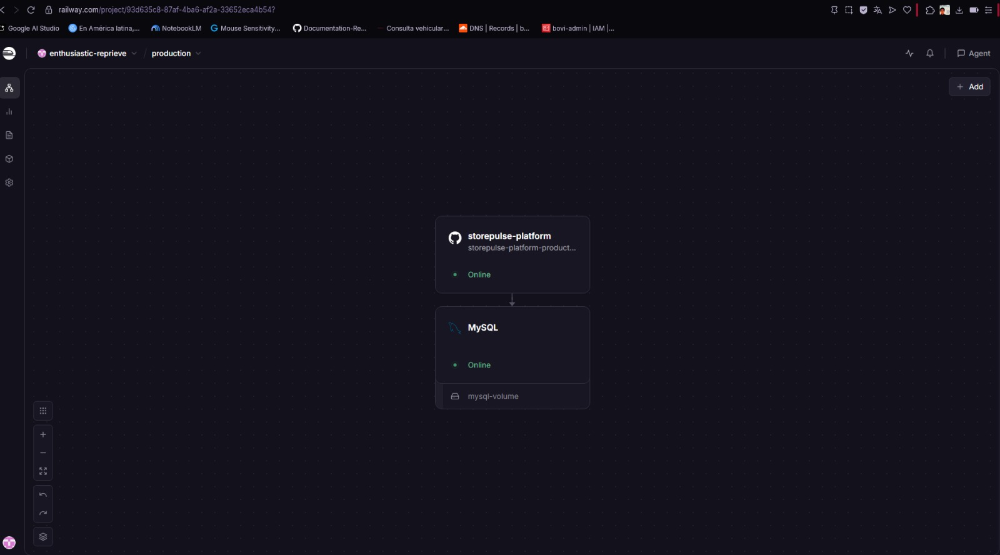

La Figura 9 presenta el historial de despliegues del servicio. El despliegue activo, originado desde GitHub, figura como `Deployment successful` y expone el dominio público `storepulse-platform-production.up.railway.app` sobre Java 21 en la región US East.

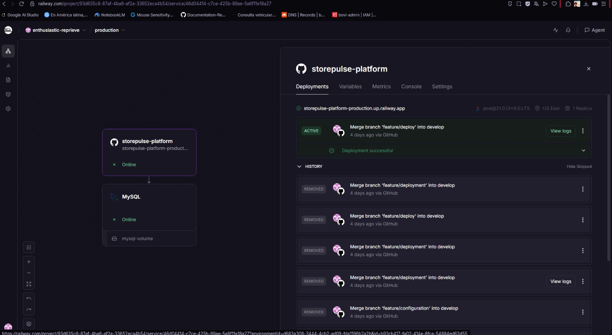

La Figura 10 corresponde a las estadísticas de la base de datos MySQL 8.4 en producción, donde se observan el tiempo de actividad, las conexiones abiertas y las consultas de lectura y escritura generadas por la aplicación.

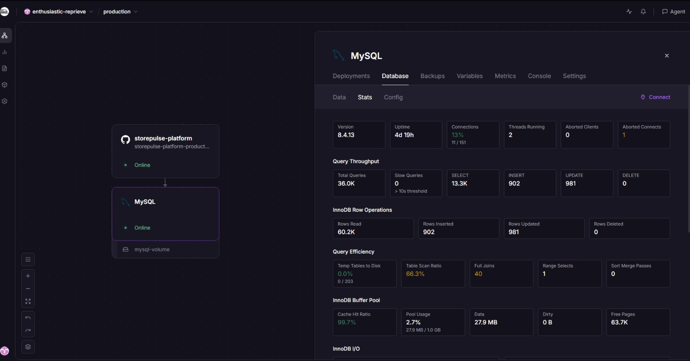

La Figura 11 muestra los registros de despliegue del servicio activo. En ellos se confirma que Tomcat inició en el puerto `8080`, que `StorepulseRestApiApplication` arrancó correctamente y que la documentación OpenAPI se inicializó al recibir solicitudes.

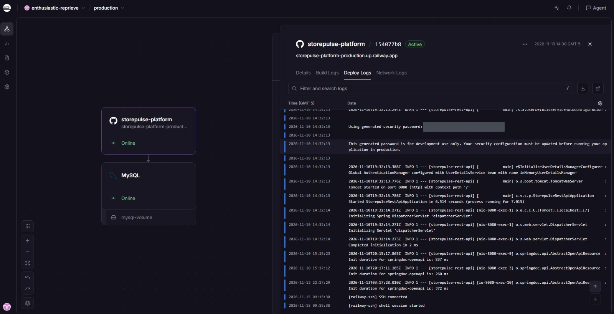

La Figura 12 presenta la documentación Swagger UI publicada en `https://storepulse-platform-production.up.railway.app/swagger-ui.html`, con la versión `1.0.0` de StorePulse REST API y sus endpoints agrupados por bounded context.

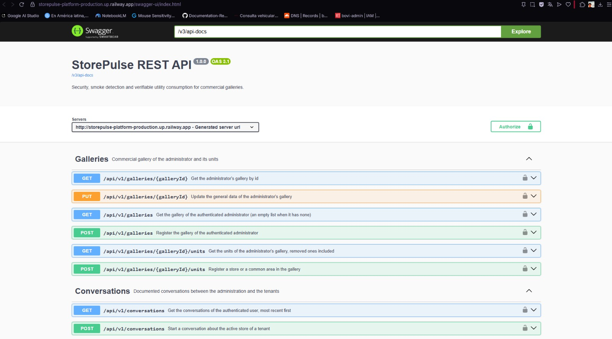

##### Despliegue de la Web Application en Firebase Hosting

La Web Application se publicó nuevamente en Firebase Hosting, en el proyecto `storepulse-web-app`, ya integrada con la REST API desplegada en Railway. La Figura 13 muestra la descripción general del proyecto en Firebase, con la última implementación de Hosting registrada el 10 de noviembre de 2026.

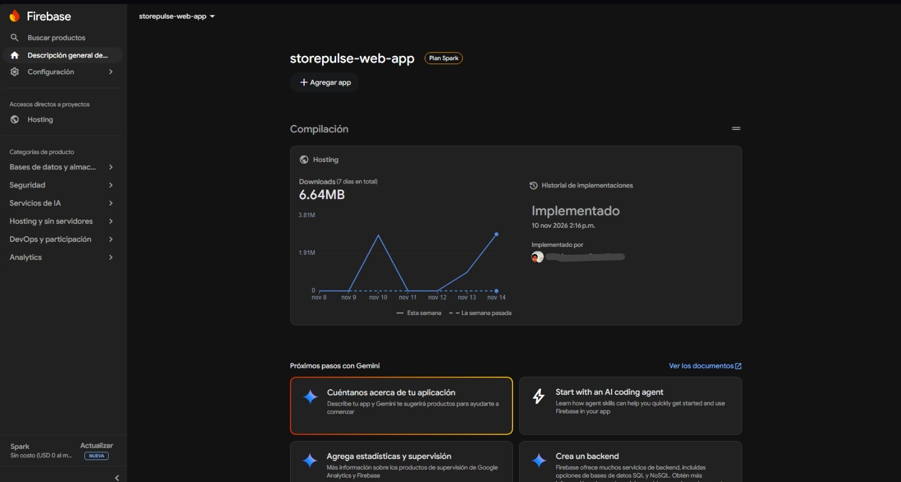

La Figura 14 presenta el panel de administración del sitio, con la versión actual publicada y las versiones anteriores, así como los dominios predeterminados `storepulse-web-app.web.app` y `storepulse-web-app.firebaseapp.com`.

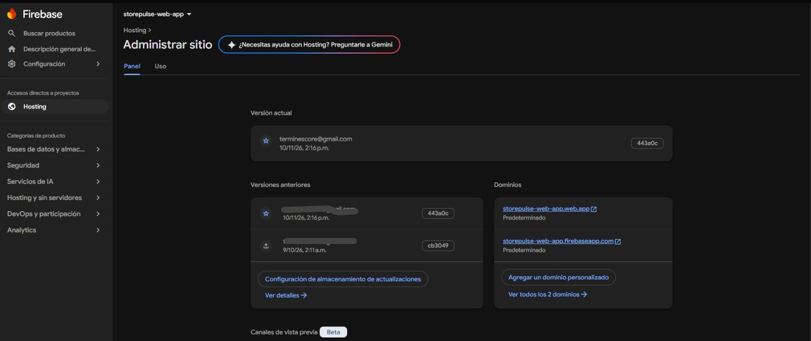

A diferencia del Sprint 1, la Figura 15 ya registra consumo del sitio: 1.12 MB de almacenamiento y 6.64 MB de descargas en el periodo de facturación, lo que evidencia accesos reales a la aplicación publicada.

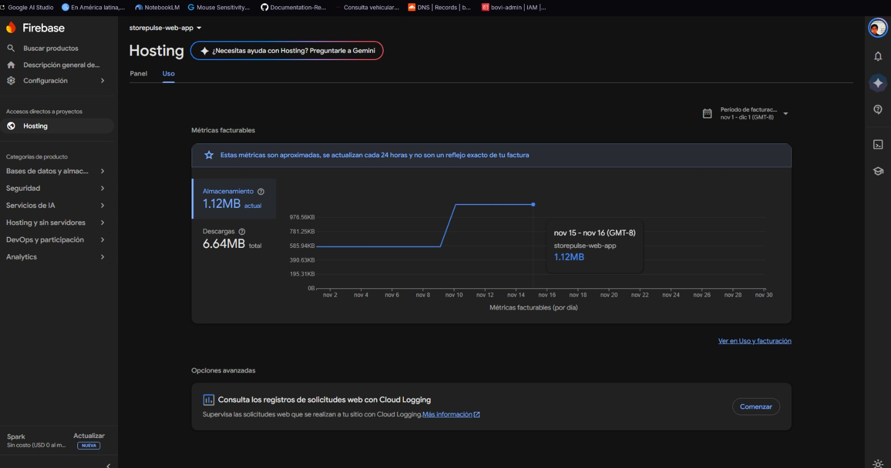

La Figura 16 muestra la pantalla de inicio de sesión de la Web Application cargada desde `https://storepulse-web-app.web.app/iam/sign-in`, punto de entrada del administrador de galería en producción.

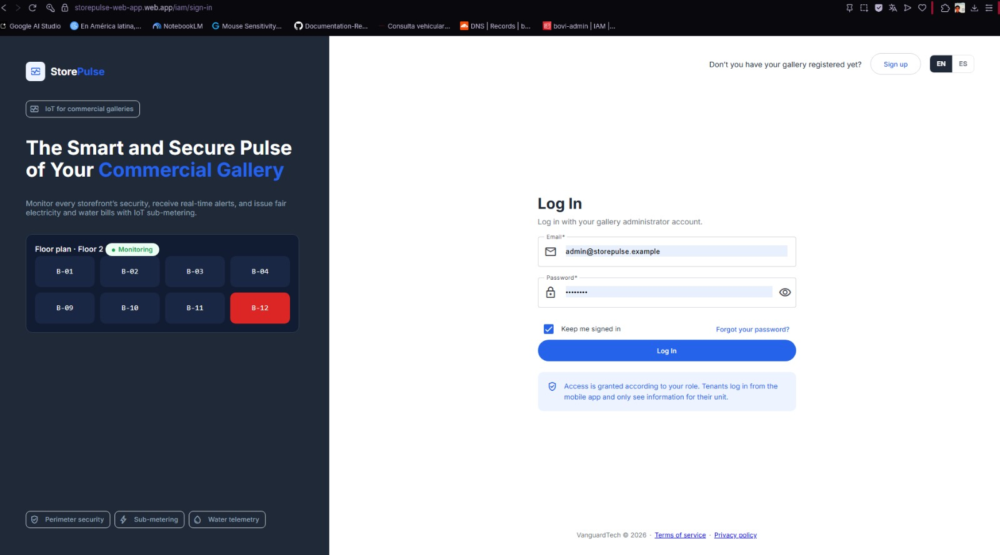

##### Despliegue del Landing Page en GitHub Pages

El Landing Page se mantiene publicado en GitHub Pages desde la rama `main` del repositorio `storepulse-landing-page`. La Figura 17 muestra el historial de despliegues del entorno `github-pages`, donde el despliegue activo corresponde a la integración de `release/2.1.0` en `main`.

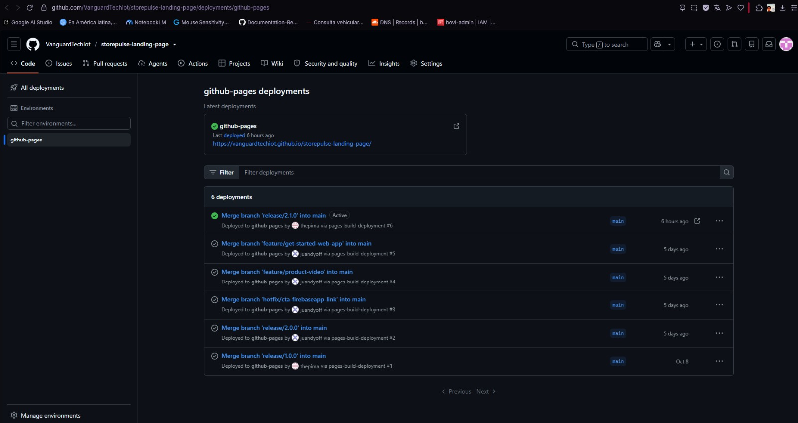

La Figura 18 presenta el Landing Page cargado en `https://vanguardtechiot.github.io/storepulse-landing-page/`, con la navegación principal, el selector de idioma y los botones de acceso hacia la Web Application.

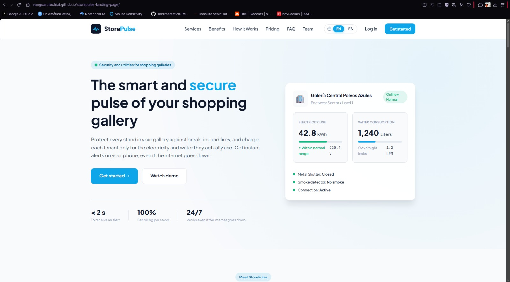

##### Distribución de la Mobile Application

La aplicación móvil para Android se distribuyó a los verificadores del equipo mediante Firebase App Distribution, en el proyecto `storepulse-mobile`. La Figura 19 muestra la versión `1.0.0 (2)`, publicada el 15 de noviembre de 2026 con la nota *Release 1.0.0: UI refinements and StorePulse branding*, junto con el número de verificadores invitados, aceptados y descargas registradas.

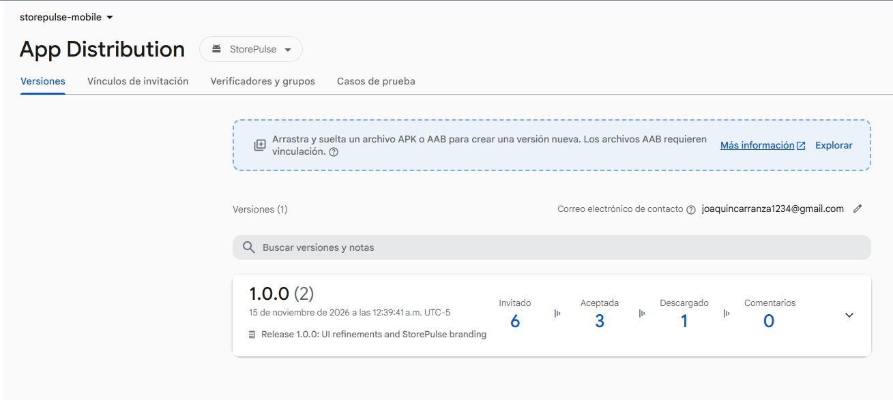

##### Ejecución del Edge Gateway

El servicio `storepulse-edge` se ejecuta en la red local de la galería con `python main.py`, escuchando en `http://0.0.0.0:5000`, y guarda su información en la base de datos local `storepulse_edge.db`. La Figura 20 evidencia su interacción con la plataforma desplegada:

1. El administrador de galería inicia sesión en la REST API de Railway (`/api/v1/authentication/sign-in`) y obtiene su token de acceso.
2. Con ese token, el Edge registra el nodo `demo-node-01` de tipo `SMOKE_NODE` (`POST /api/v1/iam/devices`) y emite su API key. El Edge verifica el token localmente con la misma clave de firma de la REST API, por lo que el registro no depende de la conexión a internet.
3. El nodo se autentica con su `device_id` y la cabecera `X-API-Key` (`POST /api/v1/iam/authentications`) y el Edge responde `authenticated: True`.
4. El nodo envía una lectura de humo de 350 (`POST /api/v1/monitoring/telemetry`). El Edge la evalúa con sus reglas locales, responde `ALERT` con la acción `SEND_ALERT` y deja el paquete almacenado para su sincronización con la plataforma.

Por seguridad, en la captura se ocultaron la contraseña de la cuenta y la API key emitida para el nodo.

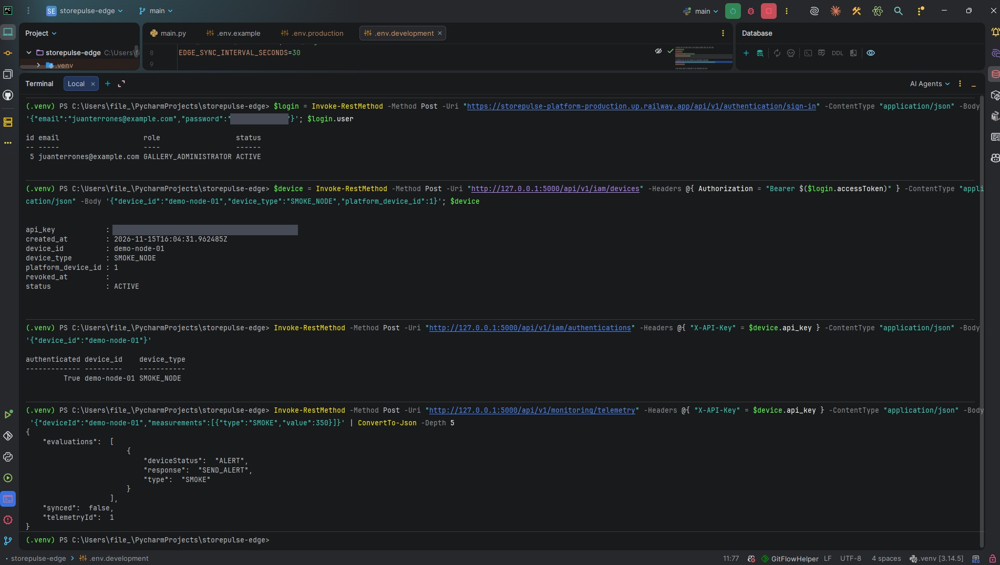

#### 6.2.2.9. Team Collaboration Insights during Sprint.

En el **Sprint 2** la colaboración del equipo se amplió del enfoque inicial en el Landing Page y el informe hacia el desarrollo paralelo en los **seis repositorios activos** (`storepulse-platform`, `storepulse-web-application`, `storepulse-edge`, `storepulse-mobile`, `storepulse-landing-page` y `storepulse-report`). Cada integrante trabajó en ramas `feature/*` y el equipo las integró en `develop` y publicó las versiones en `main` mediante ramas `release/*`, siguiendo GitFlow.

Las evidencias corresponden a la sección **Insights > Pulse** de GitHub para el periodo del 15 de octubre al 15 de noviembre de 2026. Las cifras de commits excluyen los merges:

| Repositorio | Autores | Commits | Releases publicados |
| :--- | :---: | :---: | :--- |
| `storepulse-platform` | 6 | 409 | `1.0.0` |
| `storepulse-web-application` | 4 | 171 | `2.0.0` |
| `storepulse-mobile` | 5 | 123 | `1.0.0`, `1.0.1` |
| `storepulse-edge` | 5 | 55 | `1.0.0`, `1.0.1` |
| `storepulse-landing-page` | 6 | 44 | `2.1.0` |

En conjunto, el equipo registró **802 commits** en los cinco repositorios de producto durante el sprint. El mayor volumen se concentró en `storepulse-platform`, donde participaron los seis integrantes, porque la REST API es la base que integran la Web Application, la Mobile Application y el Edge.

La Figura 21 muestra la actividad de `storepulse-platform`: seis autores con 409 commits y la publicación del release `1.0.0`, versión desplegada en Railway.

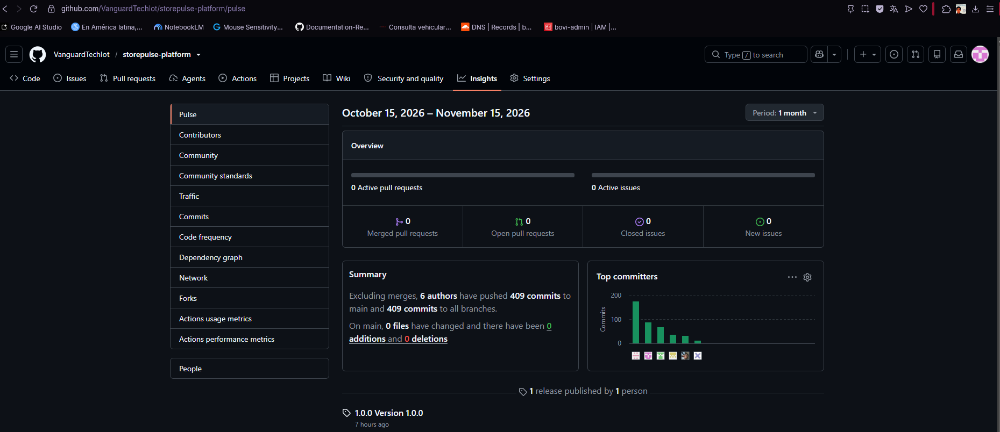

La Figura 22 corresponde a `storepulse-web-application`: cuatro autores con 171 commits y el release `2.0.0`. En `main` se modificaron 546 archivos (13,201 adiciones y 14,696 eliminaciones), producto de la migración de los datos de prueba a la REST API desplegada.

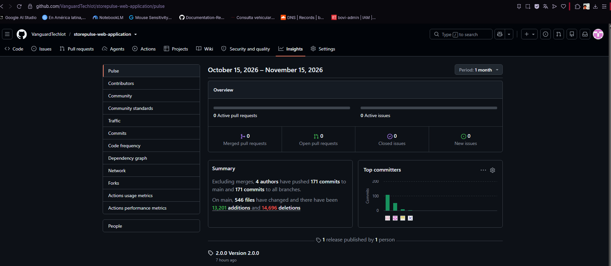

La Figura 23 presenta la actividad de `storepulse-mobile`: cinco autores con 123 commits y los releases `1.0.0` y `1.0.1` de la aplicación para Android.

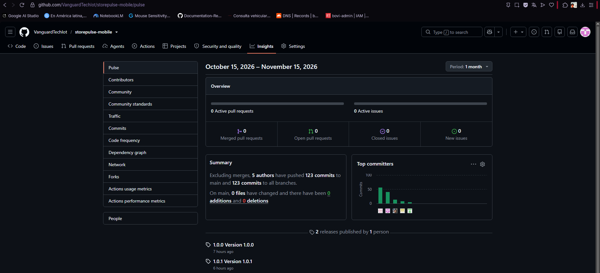

La Figura 24 muestra `storepulse-edge`: cinco autores con 55 commits y los releases `1.0.0` y `1.0.1` del Edge Gateway.

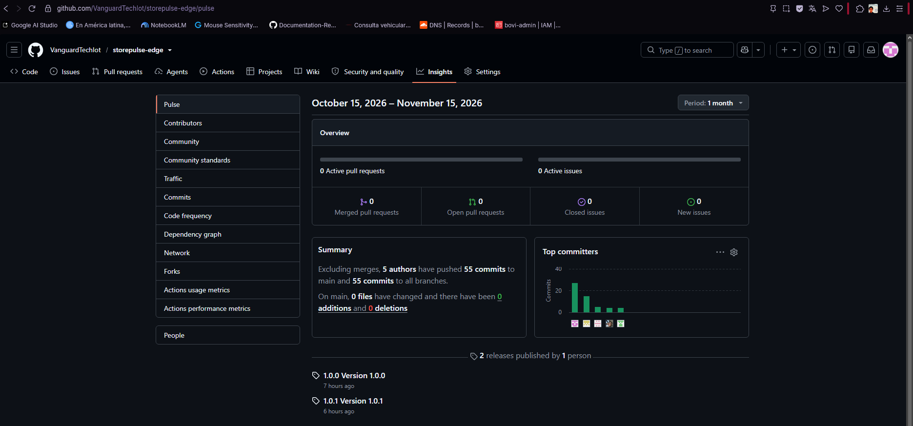

La Figura 25 corresponde a `storepulse-landing-page`: seis autores con 44 commits, 22 archivos modificados en `main` (1,207 adiciones y 239 eliminaciones) y el release `2.1.0` publicado en GitHub Pages.

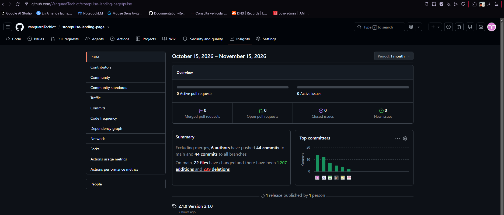

> **Agregar imagen referente a:** GitHub Insights / Pulse y gráfica de contribuciones del Sprint 2 en el repositorio `storepulse-report`.

