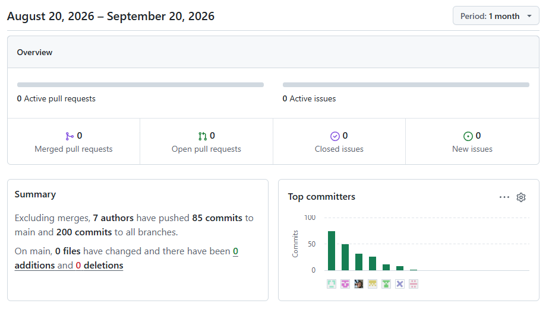
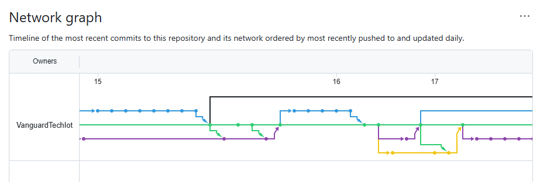
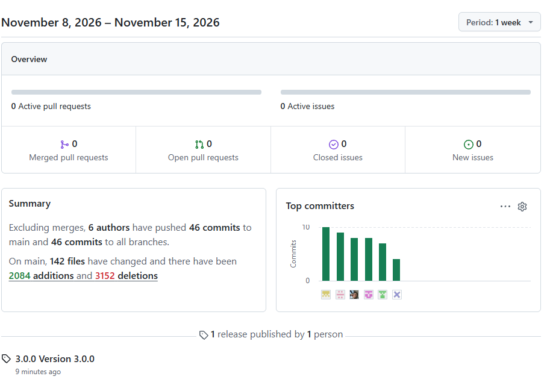
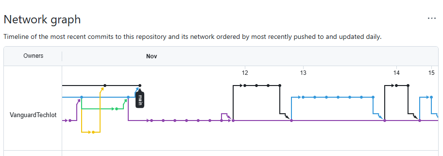

## Project Report Collaboration Insights

**Link de los repositorios de la organización:** https://github.com/VanguardTechIot

**Link del repositorio del Informe:** https://github.com/VanguardTechIot/storepulse-report

### Descripción del Trabajo Colaborativo

**Reporte de colaboración de la entrega del AV1**

**Renzo Araujo Ingunza**

Renzo condujo una de las entrevistas de Needfinding y desarrolló la parte inicial del punto 4.1, estableciendo la base del Strategic-Level DDD para el trabajo posterior del equipo. Asimismo, asumió el desarrollo de los Bounded Contexts Identity and Access Management y Analytics, llevándolos desde el EventStorming hasta su diseño táctico y elaborando los respectivos diagramas C4. Para mantener la integración del trabajo, alineó sus diagramas con las convenciones existentes del repositorio, organizó su desarrollo mediante ramas de feature independientes y documentó las dependencias con otros integrantes.

**Sebastián Córdova Valdivia**

Sebastián desarrolló el Capítulo I y la sección de Impact Mapping del Capítulo III, además de coordinar la comunicación de los cambios realizados en la distribución de los Bounded Contexts y la numeración de las secciones y archivos del Capítulo IV. También asumió los Bounded Contexts Profiles and Preferences y Subscriptions and Payments, desarrollando su EventStorming y diseño táctico mediante diagramas de clases y de base de datos en PlantUML. Aplicó GitFlow y Conventional Commits para organizar sus contribuciones e integrar los cambios del equipo de manera ordenada.

**Diaz Gutierrez, Henry Kevin**

Henry participó en la elicitación de requisitos mediante el diseño y conducción de entrevistas dirigidas al segmento Gallery Administrator, analizando los hallazgos para orientar la definición de requisitos del sistema. Asimismo, asumió el desarrollo del Bounded Context Management-Tenant Communication, organizando su diseño táctico por capas y elaborando los diagramas de componentes, clases del dominio y diseño de base de datos. Coordinó con el equipo para mantener la consistencia de las entrevistas y cumplió con los entregables asignados dentro de los plazos establecidos.

**Angelo Curi Marcelo** 

Angelo desarrolló el Ubiquitous Language y el análisis competitivo del proyecto, incluyendo el Competitive Analysis Landscape, la matriz FODA y las estrategias frente a los competidores. También elaboró los diagramas C4 de System Landscape, System Context y Container, y asumió el desarrollo de los Bounded Contexts Resource and Asset Management y Service Execution and Monitoring. Organizó su trabajo mediante ramas de feature para evitar interferencias con el desarrollo del equipo y realizó correcciones y mejoras en el informe para mantener la consistencia entre la documentación y los diagramas.

**Joaquín Enrique Carranza Tesén**

Joaquín desarrolló los Bounded Context Canvases de la sección 4.1.1.3, elaborando los diez lienzos de los contextos candidatos con la plantilla Bounded Context Canvas V4 de DDD-Crew y documentando para cada uno su propósito, clasificación estratégica, lenguaje ubicuo, reglas de negocio y comunicaciones entrantes y salientes. Este trabajo sirvió de base para el diseño táctico que cada integrante realizó en el Capítulo IV. Organizó sus contribuciones en ramas de feature independientes y las integró a develop siguiendo GitFlow y Conventional Commits.

**Reporte de colaboración de la entrega del AV2**

**Renzo Araujo Ingunza**

Renzo coordinó la integración bajo GitFlow y la publicación de las evidencias de despliegue de los servicios en producción (Railway y Firebase Hosting), actualizó la matriz de roles y responsabilidades del Sprint 2 (sección 6.2.2.2) y documentó las métricas de colaboración y distribución del equipo para la entrega AV2.

**Sebastián Córdova Valdivia**

Sebastián actualizó el IoT Device Design (sección 5.6), incorporando el actuador de alarma, nuevos diagramas de circuito, asignación de pines, diseño físico y flujos de interacción considerando el estado de salud del dispositivo, además de registrar sus avances en el Student Outcome de AV2.

**Diaz Gutierrez, Henry Kevin**

Henry condujo y documentó las Validation Interviews de Sprint 2 (sección 6.3) junto con las evidencias fotográficas de los entrevistados, incorporó los enlaces del Video About-the-Product (sección 6.4) y actualizó las conclusiones y recomendaciones finales del informe.

**Angelo Curi Marcelo**

Angelo actualizó la arquitectura del informe y los diagramas C4 y PlantUML al stack definitivo (Spring Boot 4 y StorePulse Edge en Python/Flask), completó el contexto Service Execution and Monitoring, incorporó el contexto Safety and Emergencies, redibujó los Context Maps, actualizó las Technical Stories y corrigió la tabla de contenido y el Student Outcome.

**Joaquín Enrique Carranza Tesén**

Joaquín estructuró y documentó íntegramente el Sprint 2 (sección 6.2.2: Sprint Planning 2, Sprint Backlog 2, Development Evidence, Testing Suite Evidence, Execution Evidence y Services Documentation de Platform y Edge), integró las capturas de Trello y ejecución en `assets/sprints/sprint-2/`, actualizó la tabla de contenido con los Capítulos V, VI y Anexo B, el Registro de Versiones (`02-version-log.md`) y el Student Outcome.

**Miguel Juan Diego Esquivel León**

Miguel Juan Diego incorporó su perfil de integrante en el Capítulo I (`10-startup-profile.md`) con su fotografía oficial en `assets/team/` y colaboró en la actualización de los productos digitales vinculados al Sprint 2.

### Evidencias de Analíticos y Commits en GitHub

**Reporte de colaboración de la entrega del AV1**

A continuación se presentan los gráficos de colaboración que representan la cantidad de commits realizados por cada miembro del equipo en el repositorio del informe.

**Ramificación del proyecto usando GitFlow:**

El siguiente gráfico muestra la ramificación del repositorio y las visitas registradas durante la fase AV1, evidenciando el flujo de trabajo colaborativo del equipo.

**Reporte de colaboración de la entrega del AV2**

El siguiente gráfico de **GitHub Insights > Pulse** refleja la actividad colaborativa en `storepulse-report` durante el cierre de la entrega AV2 (8 al 15 de noviembre de 2026), con los **6 autores** del equipo acumulando **46 commits** (excluyendo merges) y la publicación del release `3.0.0`.

**Ramificación del proyecto usando GitFlow (AV2):**

El siguiente gráfico muestra la evolución de ramas `feature/*`, fusiones hacia `develop` y actualización de `main` durante la fase final del Sprint 2 / AV2.

